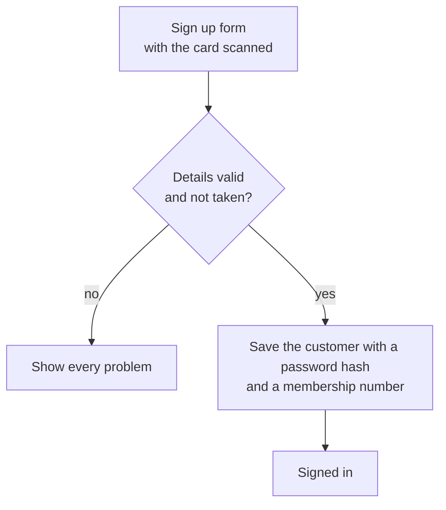
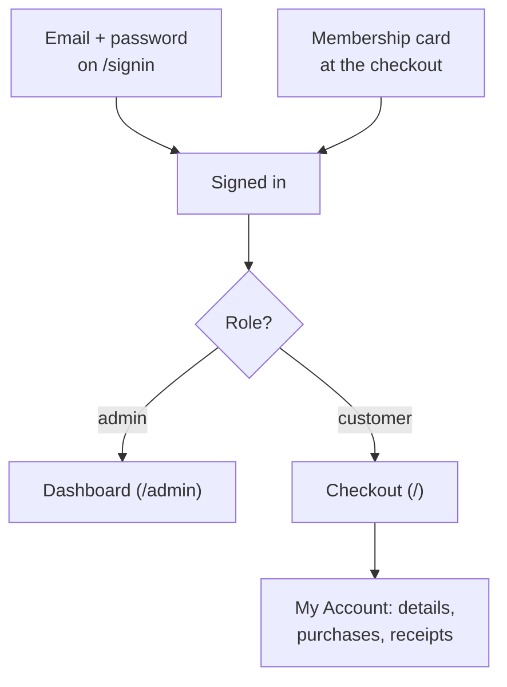
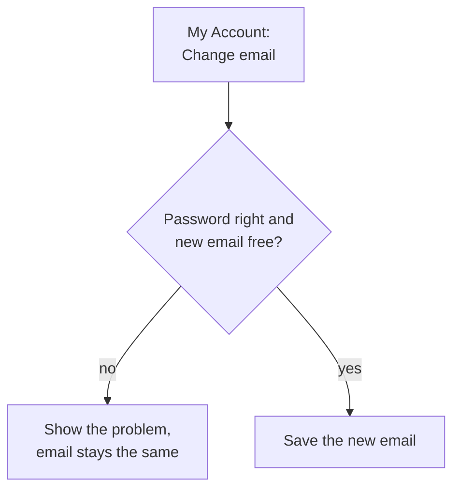

# Accounts

Everyone who signs up starts as a customer. To make the first admin, run `python -m tools.set_role`. After that, an admin can change anyone else's role on the Customers page.

## Contents
1. [Signing up](#signing-up)
2. [Signing in](#signing-in)
3. [Changing an email](#changing-an-email)
4. [Sessions and admin pages](#sessions-and-admin-pages)

## Signing up

If the email, phone number or card is already used by another account, sign up shows one message, "This email, phone number or membership card is already used by an account", without saying which. That way the form can't be used to find out whose email or card is in the store's records. The password box has a Show button.

Only a scrambled version of each password (a hash) is saved. The membership number is the barcode on the customer's card. Sign up won't go through without one, and the app never makes up a number. An admin can give someone a new card number on the Customers page, and that box can't be left empty either.

## Signing in

## Changing an email

Changing an email asks for the password because anyone holding a card can sign in by scanning it. After the change, sign in and receipts use the new address.

## Sessions and admin pages

Who is signed in is stored in the session cookie as `id`, `name` and `role`. `is_admin()` in `routes/guards.py` checks the role in the database on every request, so a role change works without signing out and back in.

| Decorator | Used on | When the user isn't an admin |
|---|---|---|
| `@admin_page` | Pages only admins can see | The sign in form with "Only admins can see this page." (403) |
| `@admin_api` | API endpoints only admins can call | JSON error "Only admins can do this." (403) |
