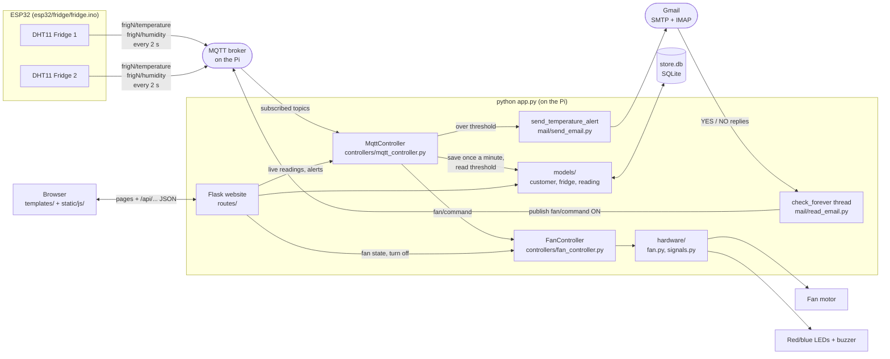
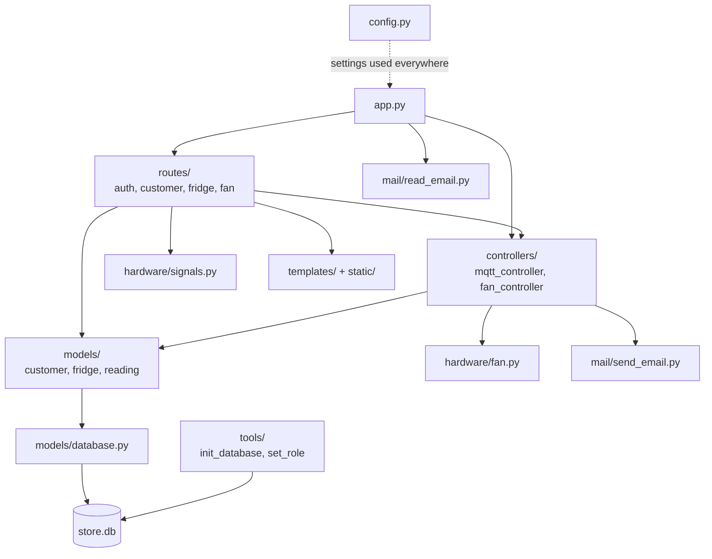
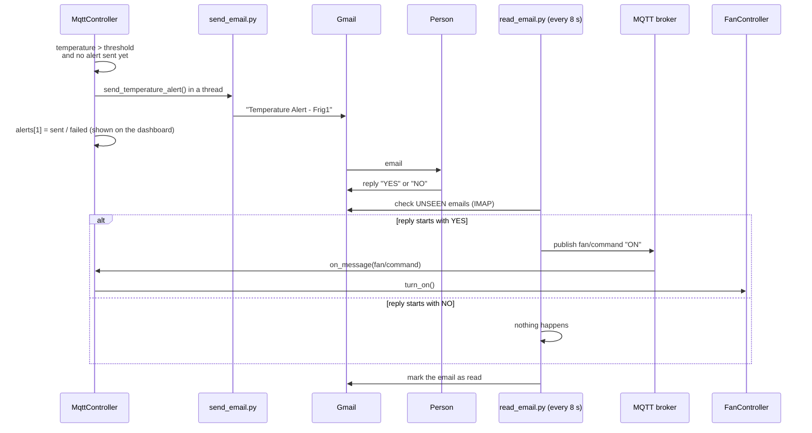
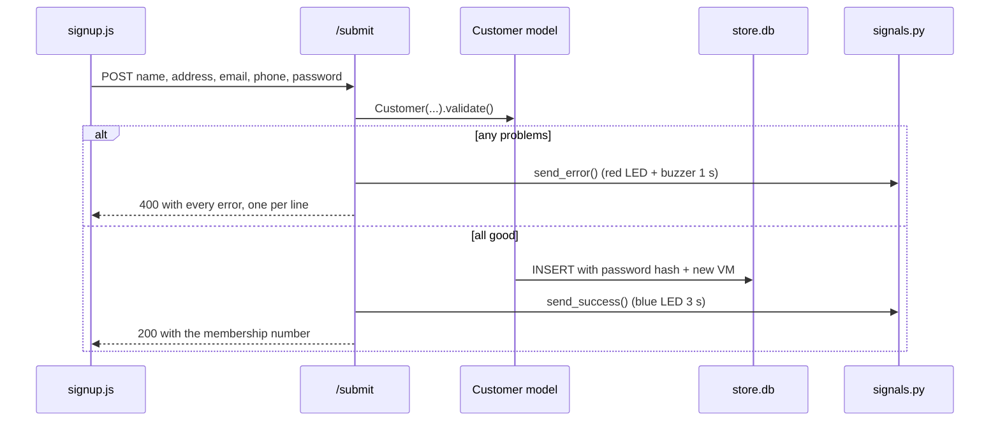

# How the app works

This page shows which parts of the fridge monitor talk to each other. After that it follows a reading from the fridge to the screen, then shows what happens when a fridge gets too warm and when someone signs up.

Everything except the ESP32 runs in one Python process on the Pi. You start it with `python app.py`.

## The big picture

There is only one `MqttController` and one `FanController`. Each is made at the bottom of its own file, and everything else imports that same copy. The routes read the newest readings straight from `mqtt_controller.readings`, so the live numbers on the dashboard don't come from the database.

With `FRIDGES_ENABLED = False` in `config.py`, app.py skips the MQTT controller and the inbox thread. The website still works, but the fridge numbers stay empty.

## Folders and who calls whom

## Pages and API endpoints

| URL | Who can open it | File | What it does |
|---|---|---|---|
| `/` | everyone | app.py | Admin home, the account page, or the public home page, depending on who is signed in |
| `/signin`, `/signout` | everyone | routes/auth_routes.py | Checks email + password, stores `id`, `name`, `role` in the session cookie |
| `/signup` | everyone | routes/customer_routes.py | Sign up form (signup.js sends it to `/submit`) |
| `/submit` (POST) | everyone | routes/customer_routes.py | Validates and saves a new customer, flashes the LEDs |
| `/account` | signed in | routes/customer_routes.py | The customer's own details and membership number |
| `/customers` | admin | routes/customer_routes.py | List of every customer |
| `/api/customers/<id>/role` (POST) | admin | routes/customer_routes.py | Change someone's role (not your own) |
| `/fridges` | admin | routes/fridge_routes.py | Dashboard with both fridges |
| `/fridges/<id>` | admin | routes/fridge_routes.py | One fridge: gauges, stats, history chart, threshold form |
| `/api/fridges` | admin | routes/fridge_routes.py | Live data for all fridges (asked every 2 s) |
| `/api/fridges/<id>` | admin | routes/fridge_routes.py | Live data for one fridge (asked every 2 s) |
| `/api/fridges/<id>/history?hours=1\|24\|168` | admin | routes/fridge_routes.py | Saved readings for the chart (asked every 60 s) |
| `/api/fridges/<id>/threshold` (POST) | admin | routes/fridge_routes.py | Change the fridge's temperature threshold |
| `/api/fan` | admin | routes/fan_routes.py | The fan's state, ON or OFF (asked every 2 s) |
| `/api/fan/off` (POST) | admin | routes/fan_routes.py | Turn the fan off |

`is_admin()` in routes/auth_routes.py checks the role in the database on every request. That's why a role change from `tools/set_role.py` works without signing out and back in.

## A sensor reading, from the fridge to the screen

`age` is the number of seconds since the last reading came in. If a sensor stops sending, you'll see that number keep going up.

## When a fridge gets too warm

You get one email per warm spell. Another one can only go out after the fridge cools to `threshold - ALERT_RESET_MARGIN`, which is 1 °C below the threshold.

A YES reply is the only thing that turns the fan on, and the dashboard's button (`/api/fan/off`) is the only thing that turns it off. The readings themselves never switch it.

## Signing up

Everyone who signs up starts as a `customer`. To make the first admin, run `python -m tools.set_role`.

## Database

`python -m tools.init_database` creates `store.db`. For now the app only uses three of its tables:

| Table | Used by | Holds |
|---|---|---|
| Customer | models/customer.py | Sign up, sign in, roles |
| Fridge | models/fridge.py | Name and temperature threshold of each fridge (2 are added by init_database) |
| Reading | models/reading.py | One temperature + humidity row per fridge per minute, for the chart and stats |

The models run their SQL through three small helpers in `models/database.py`. `query()` gives back every row, `query_one()` gives back the first row or `None`, and `execute()` saves an INSERT, UPDATE or DELETE and gives back how many rows changed. Each one opens a connection and closes it again. `get_stats()` in reading.py runs six queries in a row, so it opens one connection with `connect()` and uses it for all six.

The rest of the tables (Product, ProductItem, Purchase and so on) are for Phase 3, and nothing reads or writes them yet. They're described in [database.md](database.md).

## When the app stops

When you press Ctrl+C, the `finally` block in app.py disconnects from MQTT, turns the fan off and releases the GPIO pins, so the fan doesn't keep spinning after the app is gone.
