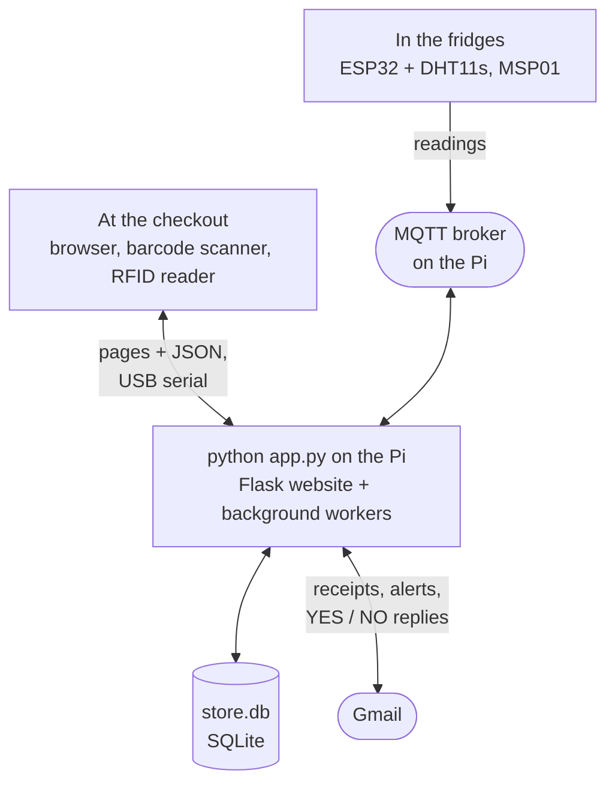
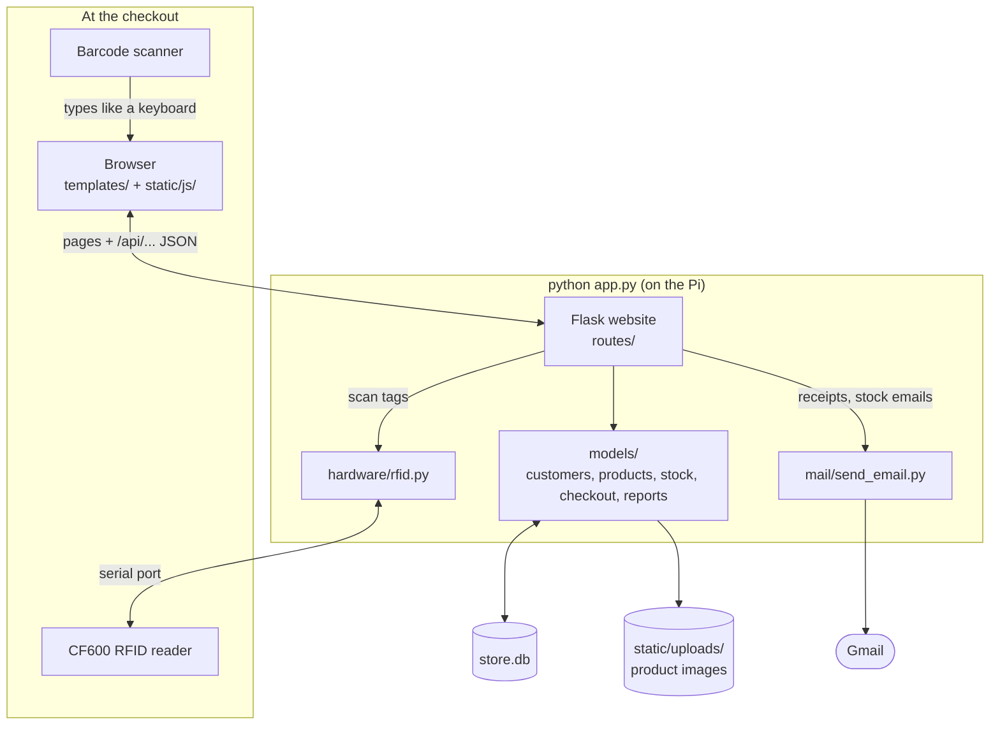
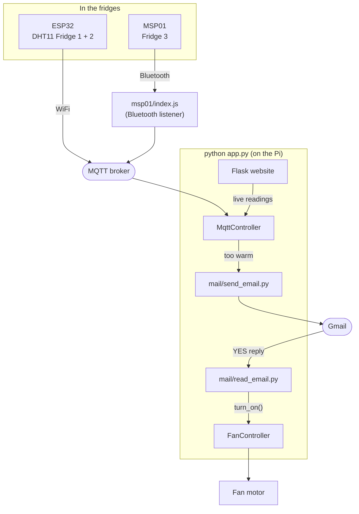
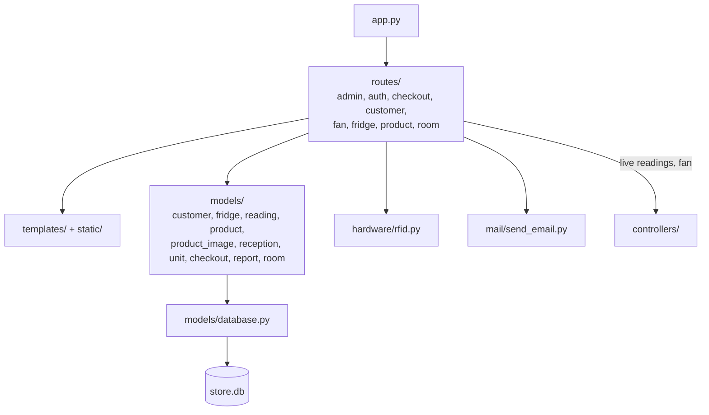
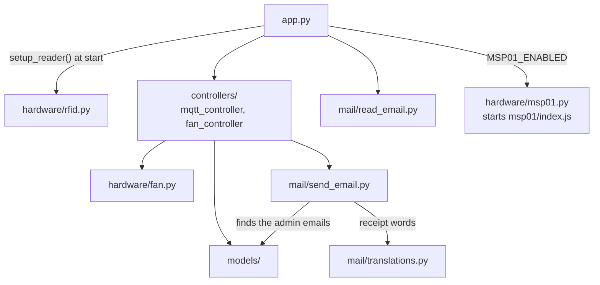

# How the app works

This app runs a small self-checkout store with monitored fridges. Customers scan their items with an RFID reader and pay at the checkout. Admins manage products, stock and customers, and keep an eye on the fridge temperatures.

Everything except the ESP32 runs on the Raspberry Pi. You start it with `python app.py`. (The MSP01's Bluetooth listener is a small Node.js program that app.py starts for you.)

This page is the overview. Each part of the app has its own doc:

| Doc | Covers |
|---|---|
| [checkout.md](checkout.md) | Scanning, signing in with a card, paying, receipts, tax and points |
| [accounts.md](accounts.md) | Sign up, sign in, roles, changing an email |
| [products-and-stock.md](products-and-stock.md) | Products, receiving deliveries, images, the inventory page, stock emails |
| [reports.md](reports.md) | The admin dashboard and the Reports page |
| [fridges.md](fridges.md) | The ESP32 sensors, temperature alerts and the fan |
| [msp01.md](msp01.md) | The Minew MSP01 Bluetooth sensor in Fridge 3 |
| [rfid-reader.md](rfid-reader.md) | The CF600 UHF RFID reader |
| [endpoints.md](endpoints.md) | Every page and API endpoint |
| [database.md](database.md) | The store tables and the ER diagram |

## Contents
1. [What each person can do](#what-each-person-can-do)
2. [The big picture](#the-big-picture)
3. [Folders and who calls whom](#folders-and-who-calls-whom)
4. [Notifications](#notifications)
5. [Charts](#charts)
6. [Languages](#languages)
7. [Database helpers](#database-helpers)
8. [When the app starts](#when-the-app-starts)
9. [When the app stops](#when-the-app-stops)
10. [Logs](#logs)

## What each person can do

| Person | What they can do |
|---|---|
| Anyone | Scan items at the checkout, sign up, sign in |
| Signed-in customer | Pay, see their purchase history, email a past receipt, change their email |
| Admin | Everything above, plus the dashboard (today's profit and the fridge temperatures) and Reports (sales, profit, tax), manage products, stock and customers, and watch the fridges |

Everyone who signs up starts as a customer. To make the first admin, run `python -m tools.set_role`.

The menu runs down the left side of every page (`templates/base.html`). Admins see Dashboard, Reports, Inventory, Fridges and Customers under "Manage", and a signed-in customer sees My Account. Inventory also stays highlighted on the product pages, which are reached from the inventory list and its Add product button. There is no separate product list: the inventory page lists every product, hidden ones included. Below the `lg` width, about 992 px, the menu is hidden and slides in from the ☰ button (Bootstrap's offcanvas). The bar across the top has the language picker and the name and role of whoever is signed in.

## The big picture

### The main parts



### The store side



More in [checkout.md](checkout.md), [products-and-stock.md](products-and-stock.md) and [rfid-reader.md](rfid-reader.md).

### The fridge side



More in [fridges.md](fridges.md) and [msp01.md](msp01.md).

## Folders and who calls whom

### A web request



### Background work



`config.py` holds the settings every file uses. `tools/` has `init_database` (creates `store.db`), `set_role` (makes an admin) and `fake_sensors` (pretends to be the ESP32s and the MSP01).

## Notifications

Every action tells the person what happened with a toast, a small box at the bottom right that fades out by itself. Success is green and errors are red and stay longer.

- A route that saves something and then reloads the page calls `flash()`. `base.html` shows each flashed message as a toast.
- A button that talks to the server without reloading the page calls `showToast(text, kind)` from `static/js/common.js`. The checkout (remove, clear, pay, receipt email), My Account (email a receipt) and the fridge pages (change the limit, turn the fan off) do this.
- Two things are not toasts on purpose: a form error is shown next to the form, and the checkout's reader messages ("Item already sold", "2 items in range could not be recognised.") stay in the basket, because they can repeat on every read and would pile up.

A page that doesn't exist shows `error.html` in the store's layout (the 404 handler in `routes/__init__.py`), and an `/api/` address gets `{"error": "Not found."}`.

Emails are notifications too: receipts ([checkout.md](checkout.md)), stock emails ([products-and-stock.md](products-and-stock.md#stock-emails)) and fridge alerts ([fridges.md](fridges.md#when-a-fridge-gets-too-warm)).

## Charts

Every chart is drawn with [Chart.js](https://www.chartjs.org/), loaded from jsDelivr like Bootstrap (so the Pi needs internet for the charts). A page with a chart loads Chart.js, then `static/js/charts.js`, then its own chart code. `charts.js` holds what every chart shares: the colours from `theme.css`, the page's font, and `dollars()` for money labels.

| Chart | Page | Drawn by | Data from |
|---|---|---|---|
| Motion today (per hour) | `/fridges/3` (the MSP01's fridge) | `static/js/fridges/room.js` | `/api/room`, every 2 seconds |
| Sales per day or month | `/reports` | `static/js/admin/reports_charts.js` | `salesBars` in the page, from `sales_chart()` |
| Sales by category (doughnut) | `/reports` | `static/js/admin/reports_charts.js` | `categories` in the page, from `sales_by_category()` |
| Temperature and humidity history | `/fridges/<id>` | `static/js/fridges/detail.js` | `/api/fridges/<id>/history`, every minute |
| Last 24 hours, time in range (doughnut) | `/fridges/<id>` | `static/js/fridges/detail.js` | `stats.inRange` from `/api/fridges/<id>`, every 2 seconds |
| All fridges, last 24 hours | `/fridges` | `static/js/fridges/dashboard.js` | `/api/fridges/<id>/history?hours=24` for each fridge, every minute |

The numbers for a chart made once are put in the page with Jinja's `tojson`, like `const salesBars = {{ bars|tojson }};`. A chart that keeps changing is made once, and then its data is replaced and `chart.update()` is called. Under the fridge history chart, the average, lowest, highest and share of readings over the limit are worked out in the browser from the same readings, for the time range picked (1 h, 24 h or 7 days). Text drawn inside a chart is not translated by the language picker.

## Languages

The pages are written in English. The language picker in the top bar offers 11 languages: English, French, Farsi, Greek, Italian, Dutch, Mandarin, Hakka, Arabic, Vietnamese and Hindi.

- `static/js/language.js` saves the choice in the `googtrans` cookie (like `/en/fr`) and reloads the page. The cookie has no expiry date, so closing the browser goes back to English.
- Google Translate translates each page in the browser. Its script is only loaded when the language isn't English, so an English page loads nothing extra. Farsi and Arabic also turn the page right to left.
- Names, money amounts and the language list itself have `notranslate` on them, so Google leaves them alone.
- Google can't run inside an email, so the receipt email has its own hand-written words in `mail/translations.py`. `send_receipt_email()` reads the same cookie, so the receipt comes in the language the customer was using when they paid or pressed Send email. The text template, the subject and the HTML template (including right to left) all use these words.
- The stock emails and the fridge alerts go to staff and are always in English.

## Database helpers

`python -m tools.init_database` creates `store.db`. [database.md](database.md) describes the store tables, like Product, ProductItem and Purchase. These tables are covered elsewhere:

| Table | Used by | Holds | Doc |
|---|---|---|---|
| Customer | models/customer.py | Sign up, sign in, roles | [accounts.md](accounts.md) |
| Fridge | models/fridge.py | Name and temperature threshold of each fridge | [fridges.md](fridges.md) |
| Reading | models/reading.py | One temperature + humidity row per fridge per minute, for the chart and stats | [fridges.md](fridges.md) |
| RoomReading, MotionEvent | models/room.py | The MSP01's readings and motion | [msp01.md](msp01.md#database) |

The models run their SQL through small helpers in `models/database.py`:

| Helper | What it does |
|---|---|
| `query()` | Gives back every row |
| `query_one()` | Gives back the first row, or `None` |
| `execute()` | Saves an INSERT, UPDATE or DELETE and gives back how many rows changed |
| `transaction()` | Runs several writes as one, for paying and receiving stock |
| `now_text()` | The current local time as text in `DATE_FORMAT` (`2026-11-06 15:03:43`), for saving dates |

Dates are saved as text in that one format, so they sort and compare correctly with `<` and `>`. Each of the first three helpers opens a connection and closes it again. `get_stats()` in reading.py runs six queries in a row, so it opens one connection with `connect()` and uses it for all six.

## When the app starts

1. app.py calls `setup_reader()` in `hardware/rfid.py`. If `RFID_PORT` (`/dev/ttyUSB0`) is missing after a reboot, it loads the driver for it. See [rfid-reader.md](rfid-reader.md#3-the-port-after-a-reboot).
2. If `FRIDGES_ENABLED` or `MSP01_ENABLED` is on, the MQTT controller loads the fridges from the database and starts. It uses `connect_async()`, so the website still starts when the broker is down, and paho keeps trying until it is back. The fridge pages show a warning meanwhile.
3. If `FRIDGES_ENABLED` is on, the thread that reads YES/NO replies starts.
4. If `MSP01_ENABLED` is on, `node msp01/index.js` starts. See [msp01.md](msp01.md).
5. Flask starts the website on port 5000.

With `FRIDGES_ENABLED = False` and `MSP01_ENABLED = False`, the website still works, but the fridge numbers stay empty.

## When the app stops

When you press Ctrl+C, the `finally` block in app.py stops the MSP01 listener, disconnects from MQTT, turns the fan off and releases the GPIO pins (`fan.cleanup()`), so the fan doesn't keep spinning after the app is gone.

## Logs

app.py sets up Python's `logging` module once, at the top. Every message goes to the screen and to `logs/app.log`, with the time, the level and the file it came from:

```
2026-11-13 18:43:32,601 INFO mail.read_email: YES received. Fan turned on.
2026-11-13 18:44:05,112 ERROR controllers.mqtt_controller: Could not save the reading for Frig1: database is locked
```

Each file that logs starts with `log = logging.getLogger(__name__)` and calls `log.info()`, `log.warning()` or `log.error()`. `log.exception()` also writes the full error, for the `except` in the MQTT handler.

`logs/app.log` is kept under 1 MB. When it fills up it becomes `app.log.1`, and the 5 newest old files are kept. The `logs/` folder is not in git. The scripts in `tools/` still use `print()`, because what they print is their answer.
