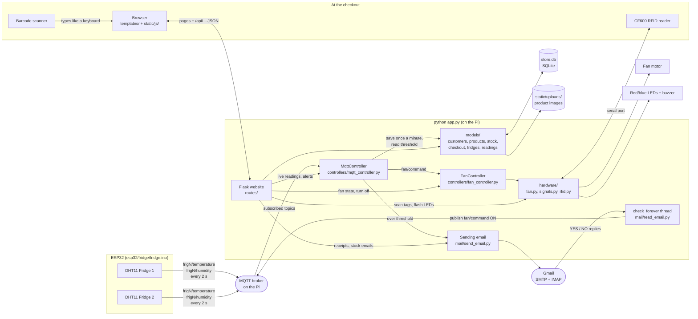
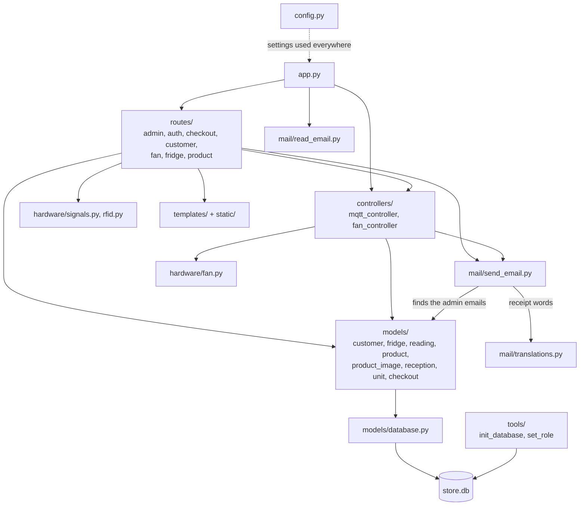
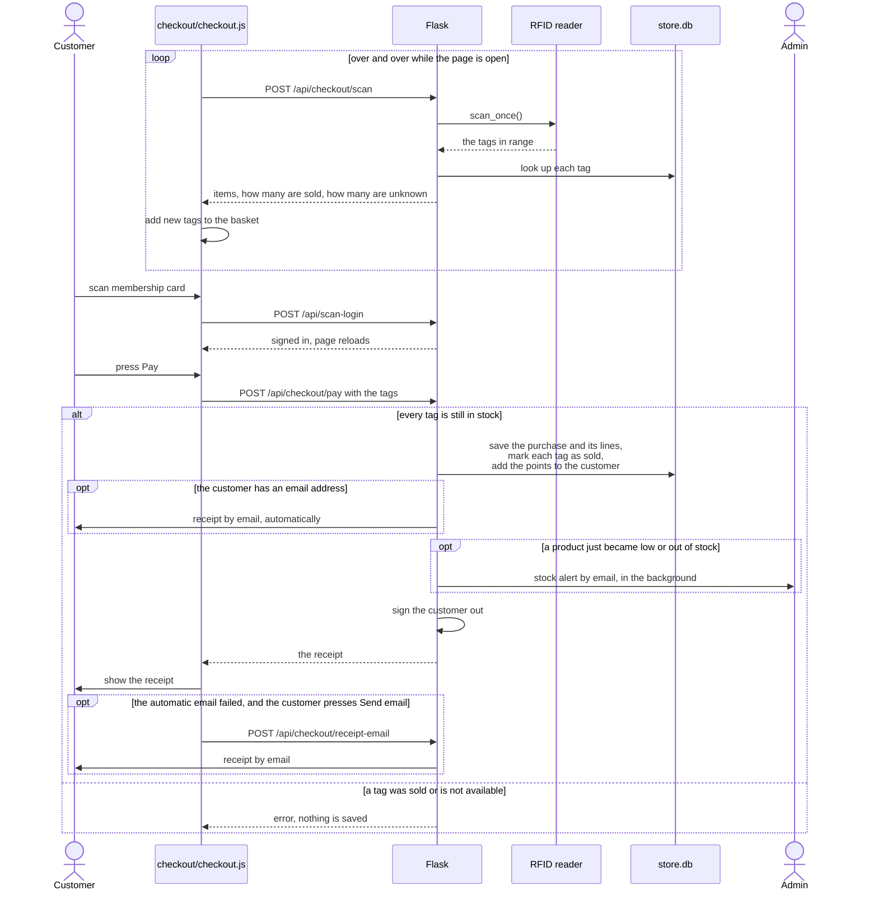
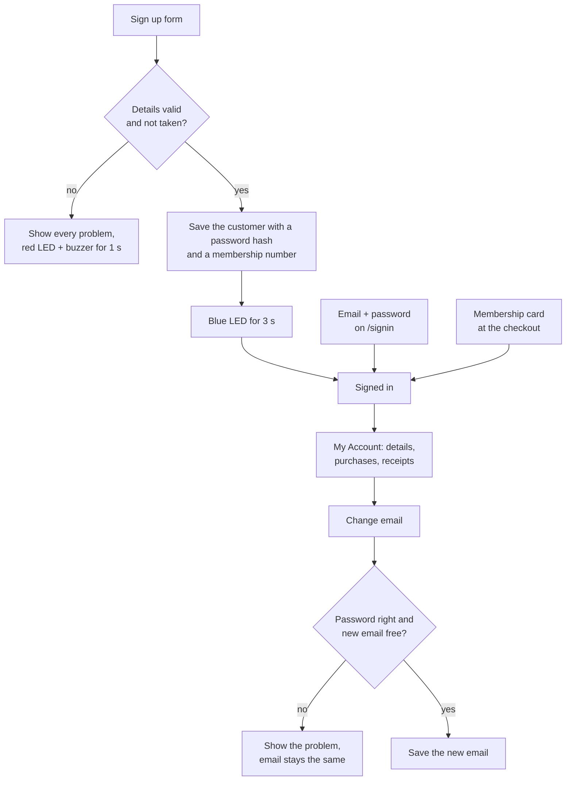
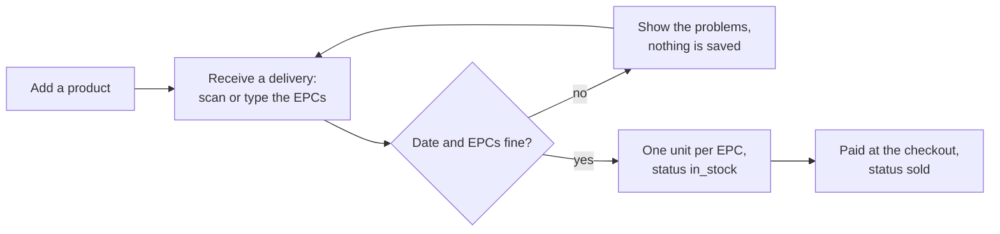
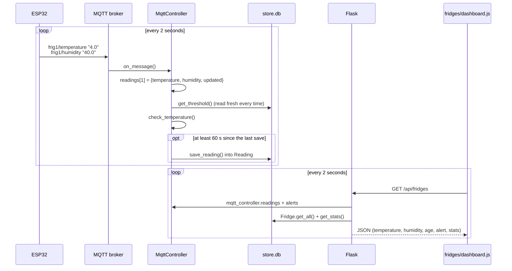
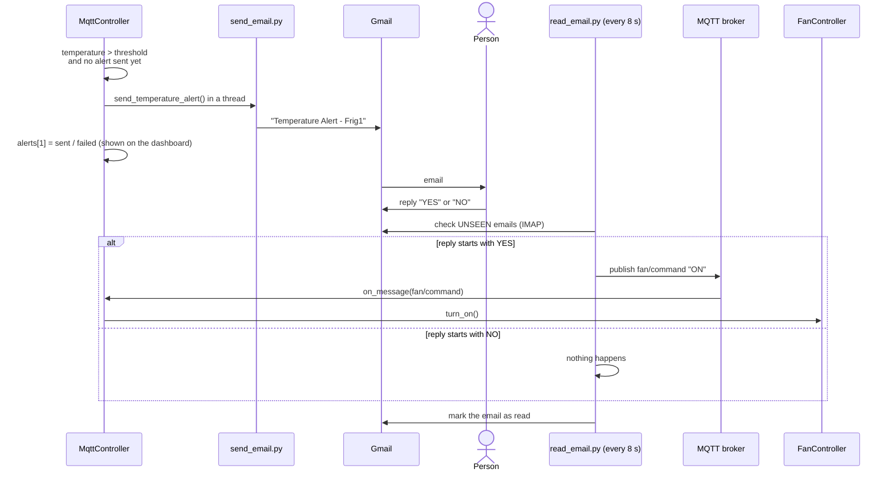

# How the app works

This app runs a small self-checkout store with two monitored fridges. Customers scan their items with an RFID reader and pay at the checkout. Admins manage products, stock and customers, and keep an eye on the fridge temperatures.

Everything except the ESP32 runs in one Python process on the Raspberry Pi. You start it with `python app.py`.

## What each person can do

| Person | What they can do |
|---|---|
| Anyone | Scan items at the checkout, sign up, sign in |
| Signed-in customer | Pay, see their purchase history, email a past receipt, change their email |
| Admin | Everything above, plus see the sales and profit, manage products, stock and customers, and watch the fridges |

Everyone who signs up starts as a customer. To make the first admin, run `python -m tools.set_role`.

## The big picture

There is only one `MqttController` and one `FanController`. Each is made at the bottom of its own file, and everything else imports that same copy. The routes read the newest readings straight from `mqtt_controller.readings`, so the live numbers on the dashboard don't come from the database.

With `FRIDGES_ENABLED = False` in `config.py`, app.py skips the MQTT controller and the inbox thread. The website still works, but the fridge numbers stay empty.

## Folders and who calls whom

## Buying something at the checkout

The checkout is the home page, and anyone can scan items on it. Paying needs someone signed in, which usually means scanning a membership card.

A few details are easy to miss:

- The basket lives in the browser. The server only learns what is in it when the customer presses Pay, and it checks every tag again at that point.
- The light at the top right of the page says whether the reader is answering. It turns to "Paying..." and stops reading while a payment goes through.
- Once someone is signed in, the summary shows their name, membership number, points balance and how many points this basket will earn. "Not you?" signs them out.
- The trash button on a line, or Clear, takes items out of the basket in the browser. A removed tag stays out until it has left the reader's range, so an item still lying on the reader isn't added straight back.
- Saving a purchase is one database transaction. If any tag can't be marked as sold, the whole purchase is cancelled.
- Every complete $5 of the subtotal (before tax) earns 10 loyalty points. The points are saved on the purchase and added to the customer's balance in that same transaction, so a cancelled purchase gives no points. The receipt and the purchase history show the points earned.
- The receipt is emailed automatically after paying, to the customer's email address, in the language picked in the menu (see [Languages](#languages)). The Send email button in the receipt window is a retry if that failed, and every purchase in My Account has the same button.
- Tax is Quebec's two sales taxes, each worked out on the subtotal of the taxable items: the federal GST (5%) and the Quebec QST (9.975%), 14.975% together. The checkout, the receipt window, the receipt email and My Account show them on separate lines. Each product has a Taxable switch on its form (on by default). Products with it off get no GST or QST. The basket shows "No tax" under their name, and the receipt window, the receipt email and My Account show it next to the line. Each receipt line saves whether it was taxed, so changing the switch later doesn't change old receipts. The checkout page shows the rates next to GST and QST. Receipts show only the amounts, so an old receipt never shows a rate that changed after it. To change them, edit `GST_RATE` and `QST_RATE` in `models/checkout.py`, and the page and the receipts follow.
- The customer is signed out right after paying, so the next person starts fresh. The session keeps the purchase number, which lets them still email that one receipt. The page reloads when they press Done, or after 60 seconds.
- A barcode scanner types like a keyboard: the number very fast, then Enter. `auth/barcode_login.js` listens for that, so a card works even when the cursor isn't in the box. An admin's card goes to the admin page instead.

Payment is a simulation. Nothing charges a real card. [phase3-status.md](phase3-status.md) tracks what is left of Phase 3.

### Notifications

Every action tells the person what happened with a toast, a small box at the bottom right that fades out by itself. Success is green and errors are red and stay longer.

- A route that saves something and then reloads the page calls `flash()`. `base.html` shows each flashed message as a toast.
- A button that talks to the server without reloading the page calls `showToast(text, kind)` from `static/js/common.js`. The checkout (remove, clear, pay, receipt email), My Account (email a receipt) and the fridge pages (change the limit, turn the fan off) do this.
- Two things are not toasts on purpose: a form error is shown next to the form, and the checkout's reader messages ("Item already sold", "Can't read items") stay in the basket, because they can repeat on every read and would pile up.

## Languages

The pages are written in English. The language picker at the top right of the menu offers 11 languages: English, French, Farsi, Greek, Italian, Dutch, Mandarin, Hakka, Arabic, Vietnamese and Hindi.

- `static/js/language.js` saves the choice in the `googtrans` cookie (like `/en/fr`) and reloads the page. The cookie has no expiry date, so closing the browser goes back to English.
- Google Translate translates each page in the browser. Its script is only loaded when the language isn't English, so an English page loads nothing extra. Farsi and Arabic also turn the page right to left.
- Names, money amounts and the language list itself have `notranslate` on them, so Google leaves them alone.
- Google can't run inside an email, so the receipt email has its own hand-written words in `mail/translations.py`. `send_receipt_email()` reads the same cookie, so the receipt comes in the language the customer was using when they paid or pressed Send email. The text template, the subject and the HTML template (including right to left) all use these words.
- The stock emails and the fridge alerts go to staff and are always in English.

## Accounts

Only a scrambled version of each password (a hash) is saved. A membership number is either the barcode scanned at sign up or a new one like `VM12345678`.

Who is signed in is stored in the session cookie as `id`, `name` and `role`. `is_admin()` in routes/guards.py checks the role in the database on every request, so a role change works without signing out and back in. Pages only admins can see have `@admin_page` above them, and API endpoints have `@admin_api`.

Changing an email asks for the password because anyone holding a card can sign in by scanning it. After the change, sign in and receipts use the new address.

## Products and stock

A product is the thing on the shelf, like "Milk 1 L". A unit is one physical item of it, with its own RFID tag. Stock isn't stored as a number. It is counted from the units still marked `in_stock`, so it can't drift away from what was received and sold.

Each product can have a cost per unit, what the store pays for it. A sale saves that cost on each receipt line, so changing a cost later doesn't change the profit of old sales. The admin page has Today, This month and All time buttons, and for that period shows the sales before tax (GST and QST go to the government), the cost of the items sold, the net profit (the first minus the second, with the margin), the GST and QST collected, the number of orders and items, and the five products that made the most profit (each one's profit counts only its units with a cost, and says how many were left out). Units sold with no cost known are left out of the cost and the profit, and the page says how many there are. `profit_summary()` and `top_products()` in `models/checkout.py` work these out.

On the receive form, the Scan tags button asks the reader again and again through `/rfid/scan`. New tags go into the box, and tags already in the system are listed but not added. A delivery can't be dated in the future and can't go on a hidden product.

Deleting a product depends on its history. With no deliveries or sales it is removed for good, along with its image. Otherwise it is only hidden, because old receipts still need it. Turning on "Show in inventory" brings it back.

Each product can have one image, handled by `models/product_image.py`. Uploads can be JPG, PNG, WebP or GIF, up to 10 MB. Opening the file with Pillow proves it really is an image, whatever its name says. It is then turned the right way up, shrunk to 800 px at most, and saved as WebP under a random name in `static/uploads/products/`. Saving it again also drops extras like a phone photo's GPS location.

The inventory page lists what needs ordering first: out of stock, then low stock, then the rest. A product counts as low when its stock is at or below its own alert level. The page can also find any unit by EPC, including sold ones, and download the stock as a CSV.

### Stock emails

Two emails go to every account with the admin role. If there are no admins, they go to `ALERT_TO` in `config.py`. Fridge alerts always go to `ALERT_TO`.

| Email | Sent when | Not sent when | Templates |
|---|---|---|---|
| Stock Alert | A sale takes a product down to its alert level or to 0. One email covers the whole basket | The product stays above its alert level, was already low and still has some left, or is hidden | `templates/email/stock_alert.html`, `.txt` |
| Restocked | A delivery arrives for a product that was low or out of stock. It says how many came in, how many are now in stock, and whether the product is still low | The product was above its alert level before the delivery | `templates/email/restocked.html`, `.txt` |

`stock_alerts()` in `models/checkout.py` picks the products for a Stock Alert, and `receive_stock()` in `routes/product_routes.py` decides on a Restocked email. `mail/send_email.py` fills in the templates during the web request, because they can't be filled in without one, then sends the email in a background thread. That way nobody waits for the email, and the sale or delivery is still saved if it fails. A failed email is not tried again, but the inventory page still shows the product as low or out.

## A sensor reading, from the fridge to the screen

`age` is the number of seconds since the last reading came in. If a sensor stops sending, that number keeps going up.

## When a fridge gets too warm

Each warm spell sends one email. Another can only go out after the fridge cools to `threshold - ALERT_RESET_MARGIN`, which is 1 °C below the threshold.

The readings never switch the fan by themselves. In normal use, a YES reply turns it on and the dashboard's button (`/api/fan/off`) turns it off. Both fridges share this one fan.

## Pages and API endpoints

| URL | Who can open it | File | What it does |
|---|---|---|---|
| `/` | everyone | routes/checkout_routes.py | The checkout: basket, summary and paying |
| `/api/checkout/scan` (POST) | everyone | routes/checkout_routes.py | Asks the RFID reader what is in the basket |
| `/api/checkout/pay` (POST) | signed in | routes/checkout_routes.py | Saves the receipt and marks the tags as sold |
| `/api/checkout/receipt-email` (POST) | after paying | routes/checkout_routes.py | Emails the receipt that was just paid |
| `/api/receipts/<id>/email` (POST) | signed in, own receipts | routes/checkout_routes.py | Emails a past receipt from the purchase history |
| `/api/scan-login` (POST) | everyone | routes/checkout_routes.py | Signs in with the barcode on a membership card |
| `/admin?period=today\|month\|all` | admin | routes/admin_routes.py | Sales, cost, profit and tax for the period (all time if left out), the best products, and a card for each dashboard |
| `/signin`, `/signout` | everyone | routes/auth_routes.py | Checks email + password, stores `id`, `name`, `role` in the session cookie |
| `/signup` | everyone | routes/customer_routes.py | Sign up form (auth/signup.js sends it to `/submit`) |
| `/submit` (POST) | everyone | routes/customer_routes.py | Validates and saves a new customer, flashes the LEDs |
| `/account` | signed in | routes/customer_routes.py | The customer's own details, membership number and purchases |
| `/account/email` (POST) | signed in | routes/customer_routes.py | Changes the customer's own email, after checking their password |
| `/customers` | admin | routes/customer_routes.py | List of every customer |
| `/api/customers/<id>/role` (POST) | admin | routes/customer_routes.py | Change someone's role (not your own) |
| `/api/customers/<id>/membership` (POST) | admin | routes/customer_routes.py | Change someone's membership number |
| `/inventory`, `/inventory.csv` | admin | routes/product_routes.py | Stock of every product, EPC search and the CSV download |
| `/products`, `/products/new` | admin | routes/product_routes.py | List of products, and the form to add one |
| `/products/<id>` | admin | routes/product_routes.py | One product: stock, receiving, deliveries and units |
| `/products/<id>/edit`, `/delete`, `/receive`, `/clear-epcs` | admin | routes/product_routes.py | Change a product or its stock |
| `/products/upc-check` | admin | routes/product_routes.py | Says if another product already has a UPC, for the product form |
| `/rfid/scan` (POST) | admin | routes/product_routes.py | Asks the RFID reader for tags, for the receive form |
| `/fridges` | admin | routes/fridge_routes.py | Dashboard with both fridges |
| `/fridges/<id>` | admin | routes/fridge_routes.py | One fridge: gauges, stats, history chart, threshold form |
| `/api/fridges` | admin | routes/fridge_routes.py | Live data for all fridges (asked every 2 s) |
| `/api/fridges/<id>` | admin | routes/fridge_routes.py | Live data for one fridge (asked every 2 s) |
| `/api/fridges/<id>/history?hours=1\|24\|168` | admin | routes/fridge_routes.py | Saved readings for the chart (asked every 60 s) |
| `/api/fridges/<id>/threshold` (POST) | admin | routes/fridge_routes.py | Change the fridge's temperature threshold |
| `/api/fan` | admin | routes/fan_routes.py | The fan's state, ON or OFF (asked every 2 s) |
| `/api/fan/off` (POST) | admin | routes/fan_routes.py | Turn the fan off |

routes/\_\_init\_\_.py adds every blueprint to the app and handles the errors they share. A database error gives a 500, and an unplugged RFID reader gives a 503.

## Database

`python -m tools.init_database` creates `store.db`. [database.md](database.md) describes the store tables, like Product, ProductItem and Purchase. These are the tables the fridges and accounts use:

| Table | Used by | Holds |
|---|---|---|
| Customer | models/customer.py | Sign up, sign in, roles |
| Fridge | models/fridge.py | Name and temperature threshold of each fridge (2 are added by init_database) |
| Reading | models/reading.py | One temperature + humidity row per fridge per minute, for the chart and stats |

The models run their SQL through small helpers in `models/database.py`:

| Helper | What it does |
|---|---|
| `query()` | Gives back every row |
| `query_one()` | Gives back the first row, or `None` |
| `execute()` | Saves an INSERT, UPDATE or DELETE and gives back how many rows changed |
| `transaction()` | Runs several writes as one, for paying and receiving stock |

Each of the first three opens a connection and closes it again. `get_stats()` in reading.py runs six queries in a row, so it opens one connection with `connect()` and uses it for all six.

## When the app stops

When you press Ctrl+C, the `finally` block in app.py disconnects from MQTT, turns the fan off and releases the GPIO pins, so the fan doesn't keep spinning after the app is gone.
