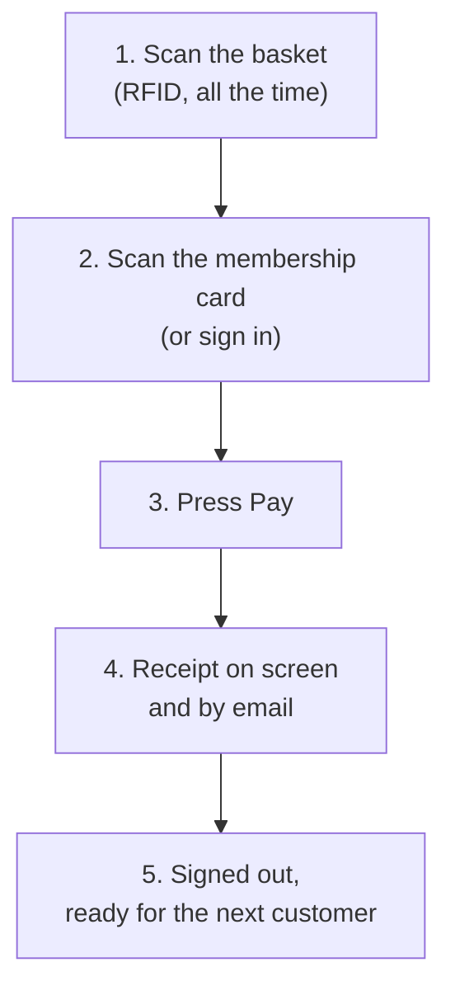
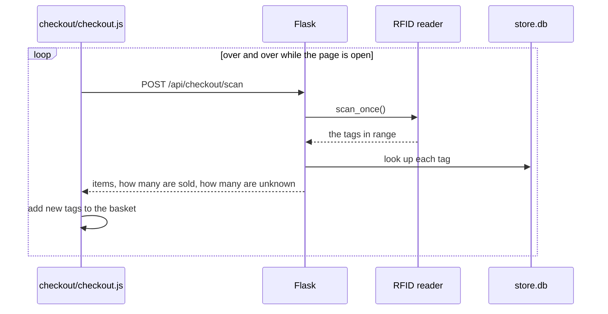
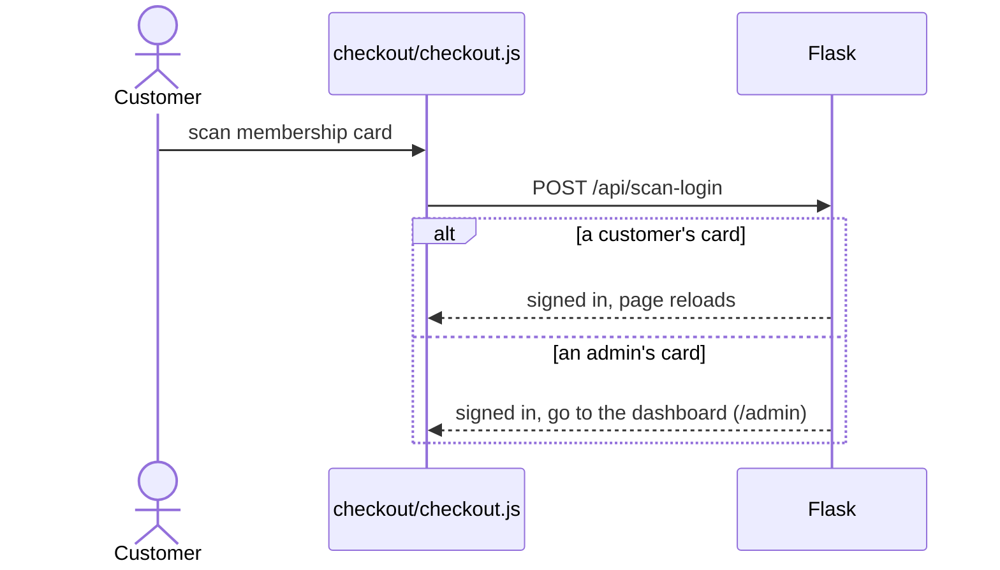
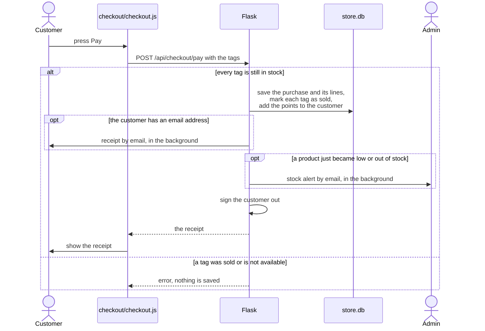
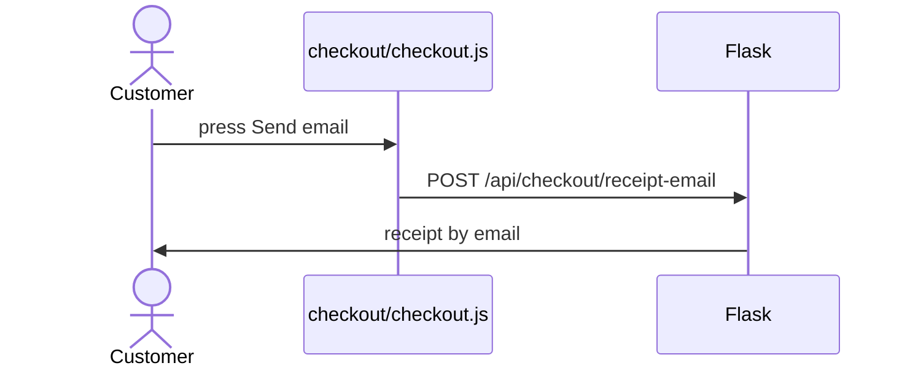

# Checkout

The checkout is the home page (`/`), and anyone can scan items on it. Paying needs someone signed in, which usually means scanning a membership card. Payment is only simulated, so no real card is charged.

For how the RFID reader itself works, see [rfid-reader.md](rfid-reader.md).

## Contents
1. [The steps](#the-steps)
2. [Scanning the basket](#scanning-the-basket)
3. [Signing in with a card](#signing-in-with-a-card)
4. [Paying](#paying)
5. [Details](#details)
6. [Tax](#tax)
7. [Loyalty points](#loyalty-points)

## The steps

## Scanning the basket

The page asks the reader for tags over and over while it is open.

## Signing in with a card

A barcode scanner types like a keyboard: the number very fast, then Enter. `auth/barcode_login.js` listens for that, so a card works even when the cursor isn't in the box.

## Paying

The receipt email is sent in a background thread, so Pay answers straight away and the customer doesn't wait for Gmail. The receipt window says "Your receipt is on its way to ...". If the email fails, it is logged, and the customer can press Send email in the receipt window:

## Details

- The basket lives in the browser. The server only learns what is in it when the customer presses Pay, and it checks every tag again at that point.
- The light next to the Checkout title says whether the reader is answering ("Reader ready" or "Reader not answering"). It turns to "Paying..." and stops reading while a payment goes through.
- Once someone is signed in, the summary shows their name, membership number, points balance and how many points this basket will earn. "Not you?" signs them out.
- With two or more of a product, the minus button on its line takes off one. The trash button takes off all of them, and Clear empties the basket. All of this happens in the browser. A removed tag stays out until it has left the reader's range, so an item still lying on the reader isn't added straight back.
- Saving a purchase is one database transaction. If any tag can't be marked as sold, the whole purchase is cancelled.
- The receipt is emailed automatically after paying, in a background thread, to the customer's email address, in the language picked in the top bar (see [Languages](architecture.md#languages)). The email is filled in during the request (templates need it), then sent by `email_in_background()` in `routes/checkout_routes.py`. The Send email button in the receipt window is a retry if that failed, and every purchase in My Account has the same button.
- The customer is signed out right after paying, so the next person starts fresh. The session keeps the purchase number, which lets them still email that one receipt. The page reloads when they press Done, or after 60 seconds.
- The reader's messages ("Item already sold", "2 items in range could not be recognised.") stay in the basket, not in toasts, because they can repeat on every read and would pile up.

## Tax

Tax is Quebec's two sales taxes, each worked out on the subtotal of the taxable items:

| Tax | Rate |
|---|---|
| GST (federal) | 5% |
| QST (Quebec) | 9.975% |
| Together | 14.975% |

- The checkout, the receipt window, the receipt email and My Account show them on separate lines.
- Each product has a Taxable switch on its form (on by default). Products with it off get no GST or QST. The basket shows "No tax" under their name, and the receipt window, the receipt email and My Account show it next to the line.
- Each receipt line saves whether it was taxed, so changing the switch later doesn't change old receipts.
- The checkout page shows the rates next to GST and QST. Receipts show only the amounts, so an old receipt never shows a rate that changed after it.
- To change the rates, edit `GST_RATE` and `QST_RATE` in `models/checkout.py`. The page and the receipts follow.

## Loyalty points

Every complete $5 of the subtotal (before tax) earns 10 loyalty points. The points are saved on the purchase and added to the customer's balance in the same transaction as the sale, so a cancelled purchase gives no points. The receipt and the purchase history show the points earned.
