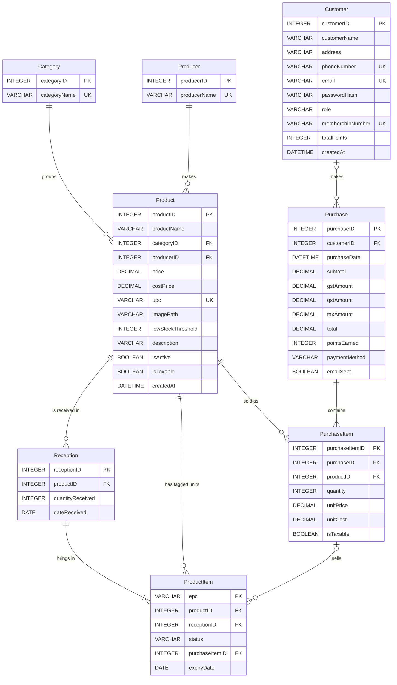

# Phase 3 database

This is the database for the self-checkout store. It keeps the products, the deliveries, the RFID-tagged items, the customers and their receipts.

Everything is in one SQLite file, `store.db` (the path is `DB_PATH` in `config.py`). You create it with `python -m tools.init_database`. Run the same command again after an update. It adds what is missing and keeps your rows, but it does remove old Product columns we no longer use (`epc`, `companyPrefix` and `itemReference`) along with anything saved in them. The Phase 2 tables, `Fridge` and `Reading`, are still in the file, but this document doesn't cover them.

## One EPC per item

A Product is defined once, with its name, price, UPC barcode. Every can or box on the shelf has its own RFID tag, and each tag's EPC is one row in ProductItem. So if we have 24 Cokes, there is 1 Coke product and 24 Coke items.

At checkout the RFID reader picks up every tag in the basket at once. Three Cokes give three EPCs, which means a quantity of 3. Once an item is paid for it is marked `sold`, so the same tag can't go through checkout twice.

We don't store a stock number anywhere. The stock of a product is just how many of its items are still `in_stock`.

## ER diagram

| Relationship | Type | Meaning |
|---|---|---|
| Category → Product | 1 : N | Each product has one category |
| Producer → Product | 1 : N | Each product has one producer |
| Product → Reception | 1 : N | A product is received many times |
| Reception → ProductItem | 1 : N | A delivery brings in its tagged units |
| Product → ProductItem | 1 : N | A product owns one EPC per unit |
| Customer → Purchase | 0..1 : N | The table allows a purchase with no customer (`customerID = NULL`), for guests. The checkout doesn't use this yet, because paying needs someone signed in |
| Purchase → PurchaseItem | 1 : N | A receipt has one line per product |
| Product → PurchaseItem | 1 : N | A product appears on many receipts |
| PurchaseItem → ProductItem | 1 : N | "3 × Coke" points to the 3 EPCs sold. A line can end up with no EPCs after "Clear all EPCs" (see below) |

## Tables

### Category and Producer
These are small lookup tables. They keep names consistent (no "Beverage" in one place and "beverages" in another). The product form suggests the names already here as you type, and a name that isn't there is added when the product is saved. Names match ignoring capitals.

### Product
| Field | Type | Rules |
|---|---|---|
| productID | INTEGER | PK |
| productName | VARCHAR(100) | required |
| categoryID | INTEGER | FK → Category, required |
| producerID | INTEGER | FK → Producer, required |
| price | DECIMAL(10,2) | required, ≥ 0 |
| isTaxable | BOOLEAN | true if the checkout charges GST and QST on it, false if not. Default true. SQLite has no real boolean type, so it saves true as 1 and false as 0, and the code turns it back with `bool()` |
| costPrice | DECIMAL(10,2) | what the store pays for one unit, ≥ 0. Optional: NULL until the admin fills it in |
| upc | VARCHAR(13) | required, unique, ≤ 13 chars |
| imagePath | VARCHAR(255) | optional, the image file inside `static/`. See "Product images" below |
| lowStockThreshold | INTEGER | default 5, ≥ 0. Low stock when stock ≤ this |
| description | VARCHAR(500) | optional, notes for the staff |
| isActive | BOOLEAN | true / false, saved as 1 / 0. Used instead of deleting a product that has history |
| createdAt | DATETIME | the app saves the local date and time |

### Reception (one delivery)
| Field | Type | Rules |
|---|---|---|
| receptionID | INTEGER | PK |
| productID | INTEGER | FK → Product, required |
| quantityReceived | INTEGER | equals the number of units (one EPC each) |
| dateReceived | DATE | required |

### ProductItem (one tagged unit)
| Field | Type | Rules |
|---|---|---|
| epc | VARCHAR(24) | PK, the unit's EPC. Typed in or scanned from the tag (hex) |
| productID | INTEGER | FK → Product, required |
| receptionID | INTEGER | FK → Reception, required |
| status | VARCHAR(10) | `in_stock` (default), `sold` or `removed`. The checkout treats a `removed` tag as unknown, but no page sets this status yet |
| purchaseItemID | INTEGER | FK → PurchaseItem, set only when sold |
| expiryDate | DATE | optional. No form or page uses it yet |

A CHECK constraint makes sure an item is `sold` if and only if it has a `purchaseItemID`.

### Customer
| Field | Type | Rules |
|---|---|---|
| customerID | INTEGER | PK |
| customerName | VARCHAR(100) | required |
| address | VARCHAR(255) | required |
| phoneNumber | VARCHAR(20) | required, unique |
| email | VARCHAR(255) | required, unique |
| passwordHash | VARCHAR(255) | required |
| role | VARCHAR(20) | `customer` (default) or `admin` |
| membershipNumber | VARCHAR(32) | required, unique, on the membership card |
| totalPoints | INTEGER | default 0, ≥ 0. Every purchase adds to it (see "Points") |
| createdAt | DATETIME | sign-up date |

### Purchase (receipt)
| Field | Type | Rules |
|---|---|---|
| purchaseID | INTEGER | PK, also the receipt number |
| customerID | INTEGER | FK → Customer. NULL would mean a guest, but the checkout always sets it for now |
| purchaseDate | DATETIME | required |
| subtotal | DECIMAL(10,2) | sum of the lines |
| gstAmount | DECIMAL(10,2) | federal GST, `GST_RATE` in `models/checkout.py` (5% of the subtotal of the taxable items), ≥ 0, default 0 |
| qstAmount | DECIMAL(10,2) | Quebec QST, `QST_RATE` in `models/checkout.py` (9.975% of the subtotal of the taxable items), ≥ 0, default 0 |
| taxAmount | DECIMAL(10,2) | gstAmount + qstAmount, default 0. Purchases from before the split were 15%, so `init_database` filled their GST as 5% of the subtotal and their QST as the rest. Old purchases that paid no tax have 0 for both |
| total | DECIMAL(10,2) | subtotal + tax |
| pointsEarned | INTEGER | the points this purchase earned, 10 for every complete $5 of the subtotal (see "Points") |
| paymentMethod | VARCHAR(20) | `card`, `cash` or `mobile`. The checkout always saves `card` |
| emailSent | BOOLEAN | true once the receipt email is sent, saved as 1 / 0 |

### PurchaseItem (receipt line)
| Field | Type | Rules |
|---|---|---|
| purchaseItemID | INTEGER | PK |
| purchaseID | INTEGER | FK → Purchase, deleted with it |
| productID | INTEGER | FK → Product |
| quantity | INTEGER | > 0, number of EPCs sold |
| unitPrice | DECIMAL(10,2) | price at the time of sale |
| unitCost | DECIMAL(10,2) | the product's `costPrice` at the time of sale, NULL if it had none. Sales from before this column existed are NULL too, and the profit uses the product's cost now for them |
| isTaxable | BOOLEAN | whether GST and QST were charged on this line, copied from the product at the time of sale. The receipts show "No tax" when it is false. Lines from before this column existed are true, unless their purchase paid no tax |

A receipt has one line per product, with the quantity on it (`UNIQUE (purchaseID, productID)`).

## How the app uses it

### Customer accounts
Signing up saves the customer with a hash of their password, never the password itself. `membershipNumber` is the barcode scanned at sign up. Emails are saved in lowercase, so `Ann@X.com` and `ann@x.com` count as the same address.

A customer can change their own email on My Account by entering their password. The new address must not belong to anyone else. An admin can change someone's `role` or `membershipNumber` on the Customers page. A new membership number has to be scanned or typed, because the app doesn't generate them.

### Adding and editing a product
The admin fills in the UPC (digits, up to 13, usually scanned first), name, category, producer company, price, and an optional cost per unit, description and low stock level. The UPC is unique. The form checks it through `/products/upc-check` before saving and links to the product that already has it, and the save checks it again. The Taxable switch (on by default) says whether the checkout charges GST and QST on the product. An empty cost is saved as NULL, and that product's sales are left out of the profit until it is filled in.

### Product images
The product form takes an optional JPG, PNG, WebP or GIF, up to 10 MB. `models/product_image.py` opens it with Pillow to prove it is really an image, turns it the right way up, shrinks it to 800 px at most, and saves it as a WebP with a random name in `static/uploads/products/`. The file is deleted when the image is replaced or removed, or when the product is deleted. A product that is only hidden keeps its image.

### Receiving a delivery
1. The admin opens the product and enters the date received, then adds the EPC of each unit. They can type the EPCs, one per line or separated by spaces or commas, or press Scan tags and hold the tags near the RFID reader. Scanning adds new tags to the box and lists any that are already in the database without adding them. The number of EPCs is the quantity.
2. The app checks them: each must be hex (0-9, A-F, up to 24 characters), none can repeat in the list, and none can already be in the database. The date can't be in the future, and the product can't be hidden. If anything is wrong, the whole delivery is rejected and nothing is saved.
3. The app saves 1 Reception and then 1 ProductItem for each EPC, all in one transaction.
4. Once it's saved, the app shows a notification, like `3 units of "Coca-Cola 500ml" received on 2026-10-30`.
5. If the product was at or below its `lowStockThreshold` before the delivery, the admins get a "Restocked" email.

### Finding units
- The product page has a Units list with every unit's EPC, the date it was received, the delivery it came in, and its status. It can be filtered by status and searched by EPC. It shows the newest 500 units.
- The Inventory page has a "Find a unit by EPC" box. It finds any unit whose EPC contains the text, across all products, and shows up to 50 matches.

### Clearing a product's EPCs
The "Clear all EPCs" button on a product's page is there for testing, so the same tags can be received again. It deletes every ProductItem and Reception of that product, including sold units. Purchase and PurchaseItem rows stay, so receipts still show the right lines, but those lines no longer point to any EPC.

### Checkout
1. The reader scans the basket and the app looks up each EPC in ProductItem. A tag already `sold` shows "Item already sold", and tags we don't know show a message saying how many couldn't be recognised. Neither goes into the basket.
2. The cart groups the items by product and shows the name, quantity, price and line total. GST and QST are worked out on the subtotal of the taxable items only, and products with `isTaxable` false show "No tax".
3. To pay, the customer must be signed in, usually by scanning their membership card. The app finds them by `membershipNumber`.
4. Paying is one transaction. The app adds the Purchase (with its `gstAmount`, `qstAmount` and `pointsEarned`) and one PurchaseItem per product (with the price, cost and taxable setting at that moment), adds the points to `Customer.totalPoints`, then marks each EPC as `sold` and links it to its line. If any tag can't be marked, nothing is saved, and no points are given.
5. The receipt is built from Purchase, PurchaseItem and Product and shown on screen, with GST and QST on separate lines, "No tax" next to untaxed lines, and the points earned. It is emailed automatically to the customer's email address. If that fails, the customer can use the Send email button, or send it later from their purchase history. When an email goes through, `emailSent` is set to true (1).
6. If the sale took a product down to its `lowStockThreshold` or to 0, the admins get a "Stock Alert" email. Hidden products are skipped.

### Stock and low stock
The `ProductStock` view has one row per active product, with `inStock`, `totalSold`, `lowStockThreshold`, `lastReceived` and `lowStock`. `lowStock` is 1 when `inStock` is at or below the product's threshold, so the dashboard can show which products need to be reordered.

The stock emails go to the `email` of every Customer whose `role` is `admin`. Nothing extra is saved for them: the app works out whether to send one from the stock count and the sale or delivery quantity, so there are no new tables or columns. See [Stock emails](products-and-stock.md#stock-emails) for the rules.

### Sales and profit
The Reports page adds up the sales for today, this month, last month or all time, and the dashboard does the same for today and yesterday. Each period is a start and an end date compared with `Purchase.purchaseDate` (`purchaseDate >= start AND purchaseDate < end`), which works because dates are saved as text that sorts in time order. Sales are `quantity × unitPrice` before tax, and the GST and QST collected come from the Purchase rows. The cost of each line is `PurchaseItem.unitCost`, or the product's `costPrice` now for older lines saved before costs were. Units with neither are left out of the cost and the profit, and the page says how many there are. Sales per category join PurchaseItem to Product and Category, and the charts group `Purchase.subtotal` by day or by month. These queries are in `models/checkout.py`, starting with `profit_summary()`. See [The dashboard and Reports](reports.md) for what each page shows.

The dashboard also lists active products whose `price` is below their `costPrice`, and active products with no `costPrice` yet (`products_below_cost()` and `products_without_cost()` in `models/product.py`).

### Points
A purchase earns 10 points for every complete $5 of the subtotal, before tax. So $12.99 earns 20 points, and $4.99 earns none. `pay()` in `models/checkout.py` saves the number as `Purchase.pointsEarned` and adds it to `Customer.totalPoints` in the same transaction as the sale. My Account shows the balance, where 100 points are worth $1 in rewards. Nothing spends the points yet.

## Rules

- Every connection runs `PRAGMA foreign_keys = ON` (in `models/database.py`). SQLite ignores foreign keys without it.
- Yes/no columns (`isActive`, `isTaxable` and `emailSent`) are BOOLEAN. SQLite has no real true/false type, so it saves True as 1 and False as 0 and gives back 1 or 0. The code turns them back into True or False with `bool()`. Databases made before this still list the columns as INTEGER, which works the same.
- The app passes the local date and time whenever it saves a row, because SQLite's defaults are in UTC. `now_text()` in `models/database.py` gives it as text like `2026-11-06 15:03:43` (`DATE_FORMAT`), so every date sorts and compares the same way. Only `Product.createdAt` has a default in the table, and the app doesn't rely on it.
- A product that has deliveries or sales is never deleted. The app sets `isActive` to false (0) instead, so it is left out of `ProductStock` but old receipts still make sense. The inventory page still lists it at the bottom, marked Hidden. A product with no history is deleted.
- An item must have the same `productID` as its reception. The app takes care of this when receiving, since both come from the same form.

The full SQL is in [tools/init_database.py](../tools/init_database.py).
