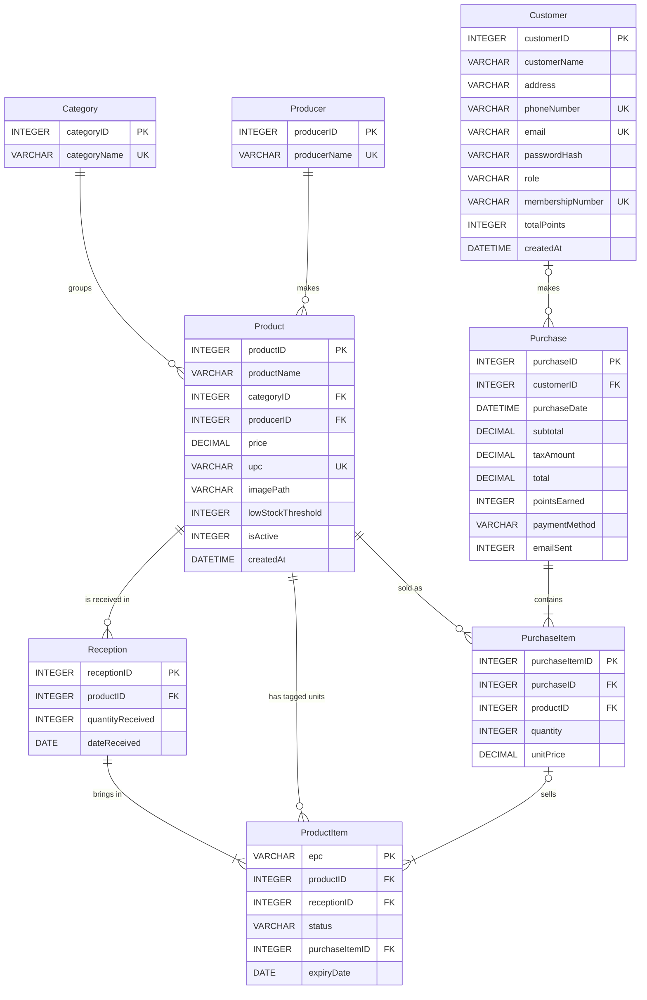

# Phase 3 database

This is the database for the self-checkout store. It keeps the products, the deliveries, the RFID-tagged items, the customers and their receipts.

Everything is in one SQLite file, `store.db` (the path is `DB_PATH` in `config.py`). You create it with `python -m tools.init_database`. The Phase 2 tables, `Fridge` and `Reading`, are still in the file, but this document doesn't cover them.

## One EPC per item

A Product is defined once, with its name, price and UPC barcode. Every can or box on the shelf has its own RFID tag, and each tag's EPC is one row in ProductItem. So if we have 24 Cokes, there is 1 Coke product and 24 Coke items.

At checkout the RFID reader picks up every tag in the basket at once. Three Cokes give three EPCs, which means a quantity of 3. Once an item is paid for it is marked `sold`, so the same tag can't go through checkout twice.

We don't store a stock number anywhere. The stock of a product is just how many of its items are still `in_stock`.

## ER diagram

| Relationship | Type | Meaning |
|---|---|---|
| Category → Product | 1 : N | Each product has one category |
| Producer → Product | 1 : N | Each product has one producer |
| Product → Reception | 1 : N | A product is received many times |
| Reception → ProductItem | 1 : N | A delivery brings in its tagged units |
| Product → ProductItem | 1 : N | A product owns one EPC per unit |
| Customer → Purchase | 0..1 : N | Guests have no customer (`customerID = NULL`) |
| Purchase → PurchaseItem | 1 : N | A receipt has one line per product |
| PurchaseItem → ProductItem | 1 : N | "3 × Coke" points to the 3 EPCs sold |

## Tables

### Category and Producer
These are small lookup tables. They keep names consistent (no "Beverage" in one place and "beverages" in another), and the admin form uses them for its dropdowns.

### Product
| Field | Type | Rules |
|---|---|---|
| productID | INTEGER | PK |
| productName | VARCHAR(100) | required |
| categoryID | INTEGER | FK → Category, required |
| producerID | INTEGER | FK → Producer, required |
| price | DECIMAL(10,2) | required, ≥ 0 |
| upc | VARCHAR(13) | required, unique, ≤ 13 chars |
| imagePath | VARCHAR(255) | optional |
| lowStockThreshold | INTEGER | default 5, ≥ 0. Low stock when stock ≤ this |
| isActive | INTEGER | 1 / 0. Used instead of deleting a product that has history |
| createdAt | DATETIME | default now |

### Reception (one delivery)
| Field | Type | Rules |
|---|---|---|
| receptionID | INTEGER | PK |
| productID | INTEGER | FK → Product, required |
| quantityReceived | INTEGER | > 0, equals the number of EPCs scanned |
| dateReceived | DATE | required |

### ProductItem (one tagged unit)
| Field | Type | Rules |
|---|---|---|
| epc | VARCHAR(24) | PK, the RFID tag |
| productID | INTEGER | FK → Product, required |
| receptionID | INTEGER | FK → Reception, required |
| status | VARCHAR(10) | `in_stock` (default), `sold` or `removed` |
| purchaseItemID | INTEGER | FK → PurchaseItem, set only when sold |
| expiryDate | DATE | optional |

A CHECK constraint makes sure an item is `sold` if and only if it has a `purchaseItemID`.

### Customer
| Field | Type | Rules |
|---|---|---|
| customerID | INTEGER | PK |
| customerName | VARCHAR(100) | required |
| address | VARCHAR(255) | required |
| phoneNumber | VARCHAR(20) | required, unique |
| email | VARCHAR(255) | required, unique |
| passwordHash | VARCHAR(255) | required |
| role | VARCHAR(20) | `customer` (default) or `admin` |
| membershipNumber | VARCHAR(12) | required, unique, on the membership card |
| totalPoints | INTEGER | default 0, ≥ 0 |
| createdAt | DATETIME | sign-up date |

### Purchase (receipt)
| Field | Type | Rules |
|---|---|---|
| purchaseID | INTEGER | PK, also the receipt number |
| customerID | INTEGER | FK → Customer, NULL for guests |
| purchaseDate | DATETIME | required |
| subtotal | DECIMAL(10,2) | sum of the lines |
| taxAmount | DECIMAL(10,2) | GST 5% + QST 9.975%, default 0 |
| total | DECIMAL(10,2) | subtotal + tax |
| pointsEarned | INTEGER | 0 for guests |
| paymentMethod | VARCHAR(20) | `card`, `cash` or `mobile` |
| emailSent | INTEGER | 1 once the receipt email is sent |

### PurchaseItem (receipt line)
| Field | Type | Rules |
|---|---|---|
| purchaseItemID | INTEGER | PK |
| purchaseID | INTEGER | FK → Purchase, deleted with it |
| productID | INTEGER | FK → Product |
| quantity | INTEGER | > 0, number of EPCs sold |
| unitPrice | DECIMAL(10,2) | price at the time of sale |

A receipt has one line per product, with the quantity on it (`UNIQUE (purchaseID, productID)`).

## How the app uses it

### Receiving a delivery
1. The admin picks the product, or scans its UPC, and puts the tagged units on the reader.
2. The app saves 1 Reception and then 1 ProductItem for each EPC, all in one transaction.
3. If one of the EPCs is already in the database, the whole delivery is rejected and nothing is saved.
4. Once it's saved, the app sends a new delivery notification, like "3 × Coke received on 2026-10-30".

### Checkout
1. The reader scans the basket and the app looks up each EPC in ProductItem. An EPC we don't know shows "Unrecognized item", and one that is already `sold` shows "Item already purchased".
2. The cart groups the items by product and shows the name, quantity, price and line total.
3. If the customer taps their membership card, the app finds them by `membershipNumber`. This step is optional.
4. Paying is one transaction. The app adds the Purchase and one PurchaseItem per product, marks each EPC as `sold` and links it to its line, then adds the points to `Customer.totalPoints`.
5. The receipt is built from Purchase, PurchaseItem and Product and emailed to the customer. When the email goes through, `emailSent` is set to 1.

### Stock and low stock
The `ProductStock` view has one row per active product, with `inStock`, `totalSold`, `lowStockThreshold`, `lastReceived` and `lowStock`. `lowStock` is 1 when `inStock` is at or below the product's threshold, so the dashboard can show which products need to be reordered.

### Points
Members get 1 point per whole dollar of the subtotal. Guests get none. The points are saved on the Purchase and added to the customer in the same transaction as the sale.

## Rules

- Every connection runs `PRAGMA foreign_keys = ON` (in `models/database.py`). SQLite ignores foreign keys without it.
- Dates have no default, because SQLite's defaults are in UTC. The app passes the local date and time when it saves a row.
- We never delete a product that already has items or receipts. We set `isActive = 0` instead, so old receipts still make sense.
- An item must have the same `productID` as its reception. The app takes care of this when receiving, since both come from the same form.

The full SQL is in [tools/init_database.py](../tools/init_database.py).
