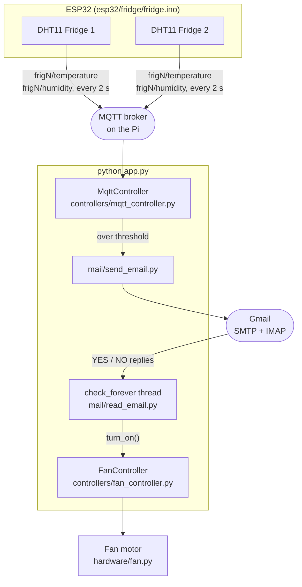
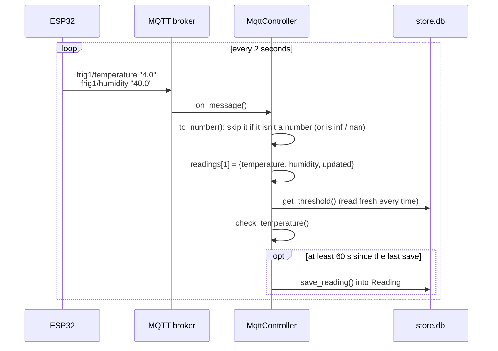
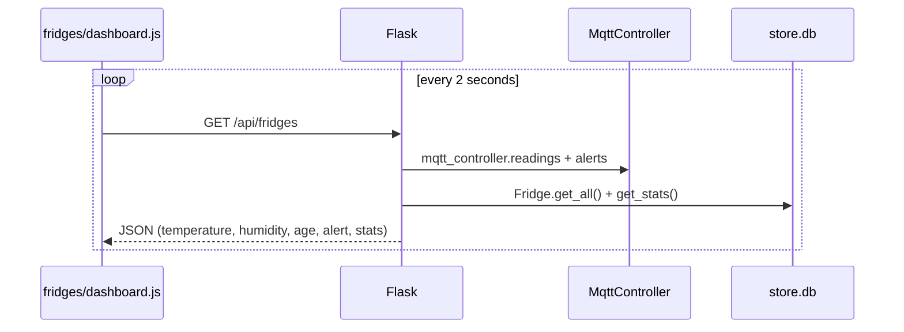
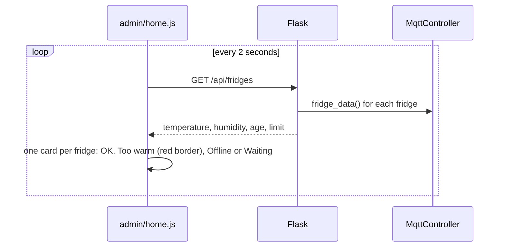
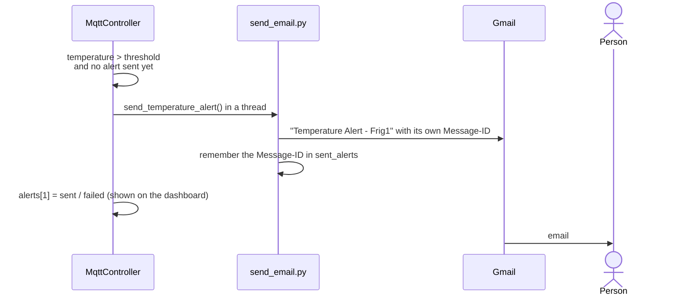
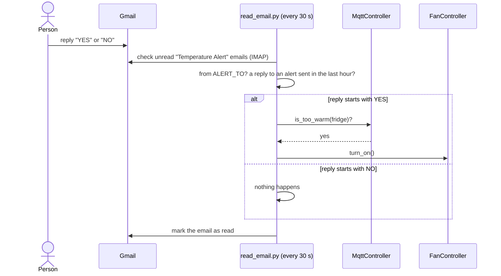

# Fridges

The store has three monitored fridges:

| Fridge | Sensor | How it sends readings |
|---|---|---|
| Fridge 1 | DHT11 on the ESP32 | WiFi → MQTT (`frig1/temperature`, `frig1/humidity`) |
| Fridge 2 | DHT11 on the ESP32 | WiFi → MQTT (`frig2/temperature`, `frig2/humidity`) |
| Fridge 3 | Minew MSP01 | Bluetooth → `msp01/index.js` → MQTT. See [msp01.md](msp01.md) |

Each fridge has a temperature threshold (limit). When a fridge gets warmer than its limit, an alert email goes out, and a YES reply turns the fan on. All three fridges share one fan.

The list of fridges comes from the `Fridge` table. When the app starts, `MqttController.load_fridges()` reads it and listens to `frigN/temperature` and `frigN/humidity` for each one (the MSP01's fridge listens to `msp01/...` instead). To add a fridge, add a row to the table and have its sensor publish to its own `frigN` topics.

A limit can be set from −30 to 30 °C on the fridge's page. A new database starts every fridge at 5 °C.

## Contents
1. [The parts](#the-parts)
2. [A reading, from the fridge to the screen](#a-reading-from-the-fridge-to-the-screen)
3. [When a fridge gets too warm](#when-a-fridge-gets-too-warm)
4. [The fan](#the-fan)
5. [Settings](#settings)
6. [Putting a password on the broker](#putting-a-password-on-the-broker)

## The parts



There is only one `MqttController` and one `FanController`. Each is made at the bottom of its own file, and everything else imports that same copy. The routes read the newest readings straight from `mqtt_controller.readings`, so the live numbers on the pages don't come from the database.

## A reading, from the fridge to the screen

### 1. The ESP32 sends a reading



### 2. The Fridges page shows it



Everything in `on_message()` is inside a `try`. If one message causes an error (bad bytes, a database that is busy), it is written to the log and the next message is handled as normal, so MQTT never stops.

`age` is the number of seconds since the last reading came in. If a sensor stops sending, that number keeps going up, and the page shows the fridge as offline after 15 seconds.

### 3. The admin dashboard shows it too



## When a fridge gets too warm

### 1. The alert is sent



Each warm spell sends one email. Another can only go out after the fridge cools to `threshold - ALERT_RESET_MARGIN`, which is 1 °C below the threshold. Fridge alerts go to `ALERT_TO` in `config.py`, in English.

### 2. The reply is read



A reply only counts if all of these are true, so a stranger's email or an old reply can't turn the fan on:

- It comes from the `ALERT_TO` address.
- It answers an alert email this app sent in the last hour. Each alert gets its own `Message-ID`, and email programs put it in the reply's `In-Reply-To` header. The list is kept in memory, so after a restart, replies to older alerts are ignored.
- The fridge is still warmer than its limit.

Other emails in the inbox are left unread.

## The fan

The readings never switch the fan by themselves. A YES reply turns it on. On the Fridges page and each fridge's page, one button turns it on or off and its label follows the fan (`/api/fan/on`, `/api/fan/off`). All the fridges share this one fan. When the app stops, it turns the fan off.

## Settings

| Setting | File | Meaning |
|---|---|---|
| `FRIDGES_ENABLED` | `config.py` | `False` runs the app without MQTT, the ESP32, the inbox thread or alert emails. The website still works, but the fridge numbers stay empty |
| `MQTT_BROKER`, `MQTT_PORT` | `config.py` | Where the broker is |
| `MQTT_USERNAME`, `MQTT_PASSWORD` | `config.py` | The broker's login. Empty if the broker has no password |
| `ALERT_TO` | `config.py` | Who gets the fridge alerts |
| `ALERT_RESET_MARGIN` | `config.py` | Degrees below the threshold before another alert can be sent (1.0) |
| `SAVE_EVERY` | `controllers/mqtt_controller.py` | How often a reading is saved (60 s) |

## Putting a password on the broker

Without a password, any device on the WiFi can send fake readings. Do this once on the Pi:

```
sudo mosquitto_passwd -c /etc/mosquitto/passwd pi        # the app and msp01/index.js
sudo mosquitto_passwd /etc/mosquitto/passwd esp32        # the ESP32
```

Then make `/etc/mosquitto/conf.d/store.conf`:

```
listener 1883
allow_anonymous false
password_file /etc/mosquitto/passwd
acl_file /etc/mosquitto/acl
```

And `/etc/mosquitto/acl`, so the ESP32 can only send its own readings:

```
user pi
topic readwrite #

user esp32
topic write frig1/#
topic write frig2/#
```

Run `sudo systemctl restart mosquitto`. Then put the logins in `MQTT_USERNAME` / `MQTT_PASSWORD` in `config.py`, and in `MQTT_USER` / `MQTT_PASS` in `esp32/fridge/config.h`, and upload the sketch again.

If the app can't reach the broker, the website still starts, and the Fridges page shows a warning until the broker is back.
