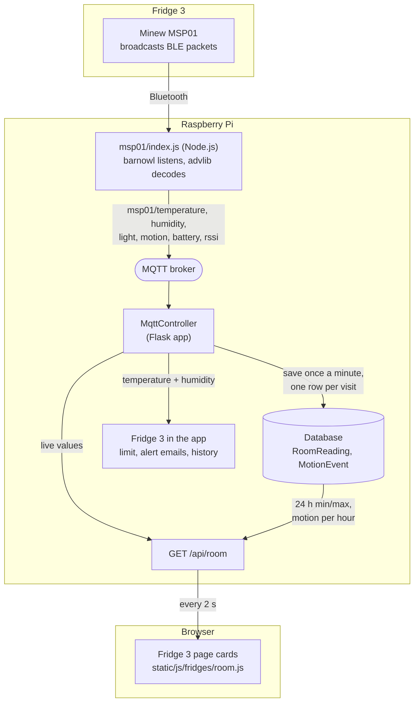

# MSP01 sensor (Fridge 3)

The Minew MSP01 is a small Bluetooth Low Energy (BLE) sensor. It sits in Fridge 3 and measures four things:

| Reading | Unit | Shown on |
|---|---|---|
| Temperature | °C | Admin dashboard, Fridge 3 page |
| Humidity | % | Admin dashboard, Fridge 3 page |
| Light | lux | Fridge 3 page |
| Motion (PIR) | yes / no | Fridge 3 page |

It also reports its battery level and how strong its signal is (RSSI).

The MSP01 doesn't connect to WiFi. It keeps broadcasting short Bluetooth packets, and the Raspberry Pi picks them up and decodes them. This was added in Phase 4 (section 5 of `Phase-4.pdf`).

## Contents
1. [How it works](#how-it-works)
2. [Files](#files)
3. [Setup](#setup)
4. [Settings](#settings)
5. [MQTT topics](#mqtt-topics)
6. [Database](#database)
7. [API](#api)
8. [Light and motion cards](#light-and-motion-cards)
9. [Fridge 3](#fridge-3)
10. [Testing without the sensor](#testing-without-the-sensor)
11. [Troubleshooting](#troubleshooting)

## How it works



1. The sensor broadcasts packets. Each one holds one kind of reading (temperature and humidity, light, motion, or battery).
2. `msp01/index.js` (Node.js) uses reelyActive's [barnowl](https://github.com/reelyactive/barnowl) to listen on the Pi's Bluetooth (`hci0`). barnowl gives each packet to us as a *raddec*: who sent it, how strong the signal was, and the packet itself. [advlib](https://github.com/reelyactive/advlib) then turns the packet into named values like `temperature` and `relativeHumidity`.
3. The Node program publishes each value to its own MQTT topic, like `msp01/temperature` → `22.0`.
4. In the Flask app, `MqttController` (`controllers/mqtt_controller.py`) subscribes to `msp01/#`. It keeps the newest values in memory and saves a reading to the database once a minute.
5. On Fridge 3's page, `static/js/fridges/room.js` calls `/api/room` every 2 seconds and updates the light and motion cards.

The listener is in Node.js because barnowl and advlib are JavaScript packages, and they already know how to read Minew packets, so we don't have to decode raw bytes ourselves. Python starts and stops the Node program for us (`hardware/msp01.py`), so you still run the project with `python app.py` alone.

## Files

| File | What it does |
|---|---|
| `msp01/index.js` | Listens on Bluetooth, decodes the MSP01 packets and publishes the readings to MQTT |
| `msp01/scan.js` | Listens for 15 seconds and lists every MSP01 in range, so you can find your sensor's address |
| `msp01/package.json` | Node packages (barnowl, barnowl-hci, advlib, mqtt) and the `npm run` commands |
| `hardware/msp01.py` | Starts `node msp01/index.js` when the app starts, and stops it when the app stops |
| `controllers/mqtt_controller.py` | Receives the `msp01/...` messages, keeps the live values, saves readings and motion |
| `models/room.py` | Saves readings and motion, and works out the 24 hour min/max and motion per hour |
| `routes/room_routes.py` | `GET /api/room`, the live values and stats as JSON (admins only) |
| `templates/fridges/detail.html` | The MSP01 light and motion cards, on the page of fridge `MSP01_FRIDGE_ID` |
| `static/js/fridges/room.js` | Fills in the cards every 2 seconds |
| `tools/init_database.py` | Creates the `RoomReading` and `MotionEvent` tables, and adds Fridge 3 |
| `tools/fake_sensors.py` | Sends fake MSP01 readings so you can test without the sensor |

## Setup

Do this once on the Raspberry Pi.

### 1. Configure the sensor
Follow reelyActive's guide: https://reelyactive.github.io/diy/minew-msp01-config/

1. Install the BeaconSET+ app on a phone and connect to the MSP01. The default password is `minew123`.
2. Keep the INFO slot.
3. Turn on the HT (temperature and humidity), PIR (motion) and light sensor slots.

### 2. Install the Node.js packages
```
sudo apt install nodejs npm     (only if node isn't installed yet)
cd msp01
npm install
npm run privileges
cd ..
```
`npm run privileges` runs `sudo setcap cap_net_raw+eip` on Node. This lets Node use the Bluetooth radio without `sudo`, as barnowl-hci asks. You need to run it again if Node gets updated.

### 3. Find your sensor's address
There may be other MSP01s nearby (a classmate's, for example). To pick yours:
```
cd msp01
npm run scan
```
Example output:
```
2 MSP01 on:

  C3:00:00:45:5D:A6   signal -58 dBm   battery 100 %   21.9 °C   heard 6 times
  C3:00:00:45:61:0B   signal -81 dBm   battery 90 %   22.4 °C   heard 2 times

Put the one you want in config.py, like  MSP01_ADDRESS = "C3:00:00:45:5D:A6"
```
The strongest signal (closest to 0) is usually the sensor closest to the Pi. The address is also printed on the back of the sensor.

### 4. Edit `config.py`
```python
MSP01_ENABLED = True
MSP01_ADDRESS = "C3:00:00:45:5D:A6"
```
`MQTT_BROKER` must point to the broker. The MSP01 starts MQTT on its own, so its cards work even with `FRIDGES_ENABLED = False`. Turn `FRIDGES_ENABLED` on too if you want the Fridge 3 warnings on the dashboard and the YES reply to alert emails (see [Fridge 3](#fridge-3)).

### 5. Create the tables and run
```
python -m tools.init_database
python app.py
```
`init_database` is safe to run again. It only adds what is missing (the `RoomReading` and `MotionEvent` tables, and Fridge 3).

When it works, the terminal shows:
```
MSP01: listening on Bluetooth with barnowl, looking for c30000455da6
MSP01: connected to MQTT at 192.168.0.100
MSP01: connected, hearing c30000455da6 (signal -58 dBm)
```

## Settings

### `config.py`
| Setting | Default | Meaning |
|---|---|---|
| `MSP01_ENABLED` | `False` | `True` to start listening, add Fridge 3 and show the light and motion cards on its page |
| `MSP01_ADDRESS` | `""` | The sensor's Bluetooth address. Empty means "use the first MSP01 heard" (its address is printed so you can copy it) |
| `MSP01_TOPIC` | `"msp01"` | The first part of every MQTT topic |
| `MSP01_FRIDGE_ID` | `3` | The fridge the sensor sits in |

### Constants in the code
| Constant | Value | File | Meaning |
|---|---|---|---|
| `SAVE_EVERY` | 60 s | `controllers/mqtt_controller.py` | How often a reading is saved to `RoomReading` |
| `MOTION_HOLD` | 30 s | `controllers/mqtt_controller.py` | Motion this close together counts as one visit. The card shows "Motion now" for this long |
| `LOST_AFTER` | 30 s | `msp01/index.js` | Silence before the terminal prints "lost" |
| `ROOM_OFFLINE_AFTER` | 60 s | `static/js/fridges/room.js` | Silence before the cards say "Offline" |
| `LIGHT_FULL` | 1000 lux | `static/js/fridges/room.js` | Light level that fills the light bar |

## MQTT topics

`msp01/index.js` publishes every value as plain text. With the default `MSP01_TOPIC`:

| Topic | Example | Meaning |
|---|---|---|
| `msp01/temperature` | `22.0` | °C, one decimal |
| `msp01/humidity` | `41.5` | Relative humidity %, one decimal |
| `msp01/light` | `320` | Light level (lux) |
| `msp01/bright` | `1` | `1` light / `0` dark. Only sent by sensors that can't measure lux |
| `msp01/motion` | `1` | `1` someone is moving / `0` nobody |
| `msp01/battery` | `100` | Battery % |
| `msp01/rssi` | `-58` | Signal strength in dBm. Closer to 0 is stronger |

To watch them live:
```
mosquitto_sub -h localhost -t "msp01/#" -v
```

## Database

Both tables are created by `tools/init_database.py`. They are not linked to the store tables.

`RoomReading` gets one row a minute, once both temperature and humidity have come in.

| Column | Type | Notes |
|---|---|---|
| `readingID` | INTEGER | Primary key |
| `temperature` | FLOAT | °C |
| `humidity` | FLOAT | % |
| `light` | INTEGER | lux, can be empty |
| `recordedAt` | DATETIME | Indexed |

`MotionEvent` gets one row each time someone starts moving in front of the sensor (a "visit").

| Column | Type | Notes |
|---|---|---|
| `motionID` | INTEGER | Primary key |
| `detectedAt` | DATETIME | Indexed |

Battery and signal strength are kept in memory only and never saved.

## API

### `GET /api/room`
Admins only. Fridge 3's page calls it every 2 seconds.

```json
{
  "temperature": 4.2,
  "humidity": 48.0,
  "light": 120,
  "bright": null,
  "battery": 100,
  "rssi": -58,
  "age": 3,
  "motion": false,
  "stats": {
    "minTemp": 3.1, "maxTemp": 5.8,
    "minHum": 40.0, "maxHum": 55.0,
    "minLight": 0, "maxLight": 410,
    "motionToday": 12,
    "motionByHour": [0, 0, 0, 0, 0, 0, 0, 0, 1, 3, 2, 0, 4, 2, 0, 0, 0, 0, 0, 0, 0, 0, 0, 0],
    "lastMotionAge": 840
  }
}
```

| Field | Meaning |
|---|---|
| `temperature`, `humidity`, `light`, `battery`, `rssi` | Newest values, or `null` before the first one |
| `bright` | `1` / `0` on sensors that only know light or dark |
| `age` | Seconds since the last message from the sensor |
| `motion` | `true` if someone moved in the last 30 seconds |
| `stats.min*`, `stats.max*` | Lowest and highest saved values of the last 24 hours |
| `stats.motionToday` | Visits since midnight |
| `stats.motionByHour` | Visits in each hour today, 24 numbers starting at midnight |
| `stats.lastMotionAge` | Seconds since the last visit, even if it was before today |

## Light and motion cards

The cards are on Fridge 3's page (`/fridges/3`), under the history chart, in the "MSP01 sensor" section. The temperature and humidity are in the gauges at the top of the same page:

| Widget | Shows |
|---|---|
| Status bar | Live / Waiting / Offline, battery, signal, time since the last reading |
| Light | Current lux with Dark (under 50) / Dim (under 300) / Bright, a bar, and the 24 hour range |
| Motion | "Motion now" (the card lights up) or "No motion", and the time since the last motion |
| Visits today | Number of visits since midnight, with one bar per hour. The current hour is darker |

The cards only appear when `MSP01_ENABLED = True`.

## Fridge 3

The MSP01's temperature and humidity are also sent to the fridge `MSP01_FRIDGE_ID` (Fridge 3). They go through the same code as the ESP32 readings for Fridges 1 and 2, so Fridge 3 gets everything the other fridges have:

- A tile on the Fridges page, and a detail page with a history chart
- A temperature limit and alert emails when it is too warm
- Replying YES to the alert email turns the fan on

Any message from the MSP01 (light, motion or battery too) counts as a sign of life, so Fridge 3 doesn't show "Offline" between temperature packets.

## Testing without the sensor

`tools/fake_sensors.py` pretends to be the ESP32 and the MSP01. Every 5 seconds it sends a temperature that drifts a little, random humidity and light, and motion about 1 time in 5.

1. In `config.py`, set `MQTT_BROKER = "localhost"`, `FRIDGES_ENABLED = True` and `MSP01_ENABLED = True`.
2. Start the app: `python app.py`.
3. In another terminal: `python3 -m tools.fake_sensors`.

`msp01/index.js` still starts with the app. If the Pi has no Bluetooth it stops with an error, but the fake readings still reach the app through MQTT.

## Troubleshooting

| Message or symptom | Cause | Fix |
|---|---|---|
| `Can't hear the MSP01: Node.js is not installed` | Node is missing | `sudo apt install nodejs npm` |
| `MSP01: can't use Bluetooth: ...` | Node isn't allowed to use the Bluetooth radio | `cd msp01 && npm run privileges`, then restart the app |
| `MSP01: no MSP01 heard yet` | The sensor is asleep, out of range, or its slots are off | Press the button on the sensor. Check the slots in BeaconSET+ (step 1). Move it closer to the Pi |
| `MSP01: not hearing c3... Other MSP01s nearby: ...` | `MSP01_ADDRESS` is wrong, or your sensor is out of range | Run `npm run scan` and copy the right address |
| `MSP01: MQTT problem: ...` | The broker isn't running or `MQTT_BROKER` is wrong | `sudo systemctl status mosquitto`, check the IP in `config.py` |
| `Could not save the MSP01 reading: no such table: RoomReading` | The tables were never created | `python -m tools.init_database` |
| Cards say "Waiting" | No message has arrived since the app started | Look at the terminal for the `MSP01:` lines above |
| Cards say "Offline" | Nothing heard for 60 seconds | Check the battery and distance. The terminal says "lost" after 30 seconds |
| Light shows "Light" / "Dark" instead of lux | This sensor version only sends light or dark | Nothing to fix. It is shown as it comes in |
| The 24 h ranges stay "--" | No reading has been saved yet | Wait one minute after the first temperature and humidity arrive |
