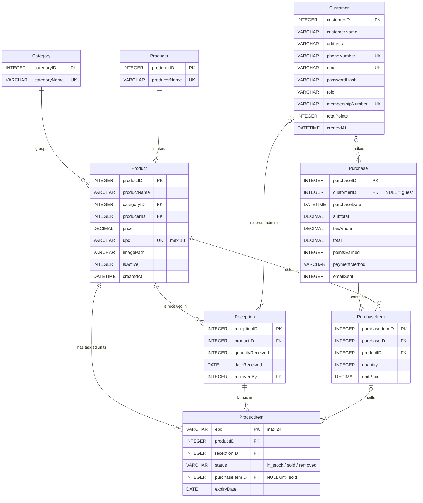

# Phase 3 – Database Design (Draft)

Smart self-checkout system: products, inventory receptions, RFID-tagged items, customers, purchases and receipts.
Database: **SQLite** (same `DB_PATH` as Phases 1–2). The existing `Customer` table is extended, not replaced.

## Key idea: one EPC per physical item

- A **Product** is defined once (name, price, UPC, ...). Its UPC barcode is the same on every unit.
- Each **physical unit** of that product carries its own RFID tag with its own **EPC**, stored as one row in **ProductItem**.
- A product therefore owns a set of EPCs. Receiving 24 Cokes = 24 new EPC rows linked to the Coke product.
- At checkout the CF600 reads every tag at once. Each EPC maps to its product, so 3 Cokes = 3 EPCs = quantity 3.
- When sold, an item is marked `sold` and linked to the receipt line, so the same tag can never be checked out twice.

## ER Diagram



### Relationships

| Relationship | Type | Meaning |
|---|---|---|
| Category → Product | 1 : N | A category holds many products; each product has one category |
| Producer → Product | 1 : N | A producer company makes many products |
| Product → Reception | 1 : N | A product is defined once but **received many times** (required by spec) |
| Product → ProductItem | 1 : N | A product owns a set of EPCs, one per physical unit |
| Reception → ProductItem | 1 : N (≥1) | Each delivery brings in the tagged units it contains; `quantityReceived` = number of EPCs |
| Customer (admin) → Reception | 0..1 : N | Optional: which admin recorded the delivery |
| Customer → Purchase | 0..1 : N | A member has many purchases; guests (no membership card) have `customerID = NULL` |
| Purchase → PurchaseItem | 1 : N (≥1) | A receipt has one line per product |
| Product → PurchaseItem | 1 : N | A product appears on many receipts |
| PurchaseItem → ProductItem | 0..1 : N | A receipt line "3 × Coke" points to the 3 EPCs that were sold |

**Purchase + PurchaseItem = the receipt.** Purchase history = `SELECT * FROM Purchase WHERE customerID = ?`.

## Tables

### Category / Producer
Pulled out of `Product` so names stay consistent (no "Beverage" vs "beverages") and can feed dropdowns in the admin form.

### Product
| Field | Type | Rules |
|---|---|---|
| productID | INTEGER | PK, autoincrement |
| productName | VARCHAR(100) | NOT NULL |
| categoryID | INTEGER | FK → Category, NOT NULL |
| producerID | INTEGER | FK → Producer, NOT NULL |
| price | DECIMAL(10,2) | NOT NULL, ≥ 0 |
| upc | VARCHAR(13) | UNIQUE, NOT NULL, ≤ 13 chars (barcode scanner) |
| imagePath | VARCHAR(255) | optional, e.g. `static/images/products/coke.png` |
| isActive | INTEGER | 1/0. "Delete" = set 0 when the product already has items or receipts, so history stays intact |
| createdAt | DATETIME | default now |

The EPC no longer lives on Product. A product's EPCs are its rows in ProductItem.

### ProductItem (one row per physical, RFID-tagged unit)
| Field | Type | Rules |
|---|---|---|
| epc | VARCHAR(24) | **PK**, ≤ 24 chars, read by the CF600 |
| productID | INTEGER | FK → Product, NOT NULL |
| receptionID | INTEGER | FK → Reception, NOT NULL: the delivery it arrived in |
| status | VARCHAR(10) | `in_stock` (default) / `sold` / `removed` (damaged, lost, expired) |
| purchaseItemID | INTEGER | FK → PurchaseItem, NULL until sold |
| expiryDate | DATE | optional, per unit |

A CHECK constraint makes sure `status = 'sold'` exactly when `purchaseItemID` is set.

### Reception (stock received)
| Field | Type | Rules |
|---|---|---|
| receptionID | INTEGER | PK |
| productID | INTEGER | FK → Product, NOT NULL |
| quantityReceived | INTEGER | NOT NULL, > 0. Equals the number of EPCs registered for this reception |
| dateReceived | DATE | NOT NULL |
| receivedBy | INTEGER | FK → Customer (admin), optional |

**Receive-stock flow:** the admin picks the product (or scans its UPC) and places the tagged units on the reader. The app creates 1 Reception row plus 1 ProductItem row per EPC read, sets `quantityReceived` to the number of EPCs, and does it all in one transaction. EPCs that are already registered are rejected (primary key).

### Customer (existing table + 3 new columns)
| New field | Type | Rules |
|---|---|---|
| membershipNumber | VARCHAR(12) | UNIQUE, auto-generated at sign-up (e.g. `VM` + 8 digits). Encoded on the membership card |
| totalPoints | INTEGER | NOT NULL, default 0 |
| createdAt | DATETIME | set at sign-up |

### Purchase (receipt header)
| Field | Type | Rules |
|---|---|---|
| purchaseID | INTEGER | PK; also the receipt number |
| customerID | INTEGER | FK → Customer, **nullable** (guest checkout) |
| purchaseDate | DATETIME | NOT NULL (receipt date & time) |
| subtotal | DECIMAL(10,2) | sum of line totals |
| taxAmount | DECIMAL(10,2) | GST 5% + QST 9.975% (optional; set to 0 to skip taxes) |
| total | DECIMAL(10,2) | subtotal + tax |
| pointsEarned | INTEGER | from the points rule below; 0 for guests |
| paymentMethod | VARCHAR(20) | `card` / `cash` / `mobile` (simulated) |
| emailSent | INTEGER | 1 when the emailed receipt succeeded |

### PurchaseItem (receipt lines)
| Field | Type | Rules |
|---|---|---|
| purchaseItemID | INTEGER | PK |
| purchaseID | INTEGER | FK → Purchase, ON DELETE CASCADE |
| productID | INTEGER | FK → Product |
| quantity | INTEGER | > 0. Equals the number of EPCs sold on this line |
| unitPrice | DECIMAL(10,2) | **price at the time of sale**, so editing a product's price later doesn't change old receipts |

UNIQUE (purchaseID, productID): one line per product, with quantity.

## Checkout flow vs. the tables

1. **Scan:** the reader returns a set of EPCs. Look them up: `SELECT ... FROM ProductItem JOIN Product ... WHERE epc IN (...) AND status = 'in_stock'`.
   - Unknown EPC → warning ("Unrecognized item").
   - EPC already `sold` → warning ("Item already purchased").
2. **Cart:** group by product → name, quantity, unit price, line total. Removing an item drops its EPC from the cart (nothing is written to the database yet).
3. **Membership card** → look up `Customer` by `membershipNumber` (optional).
4. **Pay** (one transaction):
   - INSERT the Purchase row, then one PurchaseItem per product.
   - UPDATE ProductItem SET `status = 'sold'`, `purchaseItemID = ?` for each EPC.
   - UPDATE Customer SET `totalPoints = totalPoints + ?`.
5. **Receipt:** build it from Purchase + PurchaseItem + Product, email it, and set `emailSent = 1`.

## Stock in hand (derived, not stored)

```
stock = COUNT(ProductItem WHERE status = 'in_stock')
```

Each unit is tracked, so stock is just a count of unsold tags. This is exposed as the `ProductStock` view for the inventory dashboard.

## Points strategy (proposal)

- **1 point per whole dollar** of the subtotal (`floor(subtotal)`), members only.
- Saved on `Purchase.pointsEarned` and added to `Customer.totalPoints` in the **same transaction** as the purchase.
- Easy to extend later (e.g. double points for a category, redeeming 100 pts = $1).

## SQL (SQLite)

```sql
PRAGMA foreign_keys = ON;   -- must be run on every connection in SQLite

CREATE TABLE IF NOT EXISTS Category (
    categoryID   INTEGER PRIMARY KEY AUTOINCREMENT,
    categoryName VARCHAR(50) NOT NULL UNIQUE
);

CREATE TABLE IF NOT EXISTS Producer (
    producerID   INTEGER PRIMARY KEY AUTOINCREMENT,
    producerName VARCHAR(100) NOT NULL UNIQUE
);

CREATE TABLE IF NOT EXISTS Product (
    productID   INTEGER PRIMARY KEY AUTOINCREMENT,
    productName VARCHAR(100) NOT NULL,
    categoryID  INTEGER NOT NULL REFERENCES Category(categoryID),
    producerID  INTEGER NOT NULL REFERENCES Producer(producerID),
    price       DECIMAL(10,2) NOT NULL CHECK (price >= 0),
    upc         VARCHAR(13) NOT NULL UNIQUE CHECK (length(upc) <= 13),
    imagePath   VARCHAR(255),
    isActive    INTEGER NOT NULL DEFAULT 1 CHECK (isActive IN (0, 1)),
    createdAt   DATETIME NOT NULL DEFAULT CURRENT_TIMESTAMP
);

CREATE TABLE IF NOT EXISTS Reception (
    receptionID      INTEGER PRIMARY KEY AUTOINCREMENT,
    productID        INTEGER NOT NULL REFERENCES Product(productID),
    quantityReceived INTEGER NOT NULL CHECK (quantityReceived > 0),
    dateReceived     DATE NOT NULL,
    receivedBy       INTEGER REFERENCES Customer(customerID)
);

-- Customer (implemented in tools/init_database.py; fresh database for Phase 3)
CREATE TABLE IF NOT EXISTS Customer (
    customerID       INTEGER PRIMARY KEY AUTOINCREMENT,
    customerName     VARCHAR(100) NOT NULL,
    address          VARCHAR(255) NOT NULL,
    phoneNumber      VARCHAR(20) NOT NULL UNIQUE,
    email            VARCHAR(255) NOT NULL UNIQUE,
    passwordHash     VARCHAR(255) NOT NULL,
    role             VARCHAR(20) NOT NULL DEFAULT 'customer'
        CHECK (role IN ('customer', 'admin')),
    membershipNumber VARCHAR(12) NOT NULL UNIQUE,
    totalPoints      INTEGER NOT NULL DEFAULT 0 CHECK (totalPoints >= 0),
    createdAt        DATETIME NOT NULL
);

CREATE TABLE IF NOT EXISTS Purchase (
    purchaseID    INTEGER PRIMARY KEY AUTOINCREMENT,
    customerID    INTEGER REFERENCES Customer(customerID),
    purchaseDate  DATETIME NOT NULL,
    subtotal      DECIMAL(10,2) NOT NULL CHECK (subtotal >= 0),
    taxAmount     DECIMAL(10,2) NOT NULL DEFAULT 0,
    total         DECIMAL(10,2) NOT NULL CHECK (total >= 0),
    pointsEarned  INTEGER NOT NULL DEFAULT 0,
    paymentMethod VARCHAR(20) NOT NULL DEFAULT 'card'
        CHECK (paymentMethod IN ('card', 'cash', 'mobile')),
    emailSent     INTEGER NOT NULL DEFAULT 0 CHECK (emailSent IN (0, 1))
);

CREATE TABLE IF NOT EXISTS PurchaseItem (
    purchaseItemID INTEGER PRIMARY KEY AUTOINCREMENT,
    purchaseID     INTEGER NOT NULL REFERENCES Purchase(purchaseID) ON DELETE CASCADE,
    productID      INTEGER NOT NULL REFERENCES Product(productID),
    quantity       INTEGER NOT NULL CHECK (quantity > 0),
    unitPrice      DECIMAL(10,2) NOT NULL CHECK (unitPrice >= 0),
    UNIQUE (purchaseID, productID)
);

CREATE TABLE IF NOT EXISTS ProductItem (
    epc            VARCHAR(24) PRIMARY KEY CHECK (length(epc) <= 24),
    productID      INTEGER NOT NULL REFERENCES Product(productID),
    receptionID    INTEGER NOT NULL REFERENCES Reception(receptionID),
    status         VARCHAR(10) NOT NULL DEFAULT 'in_stock'
        CHECK (status IN ('in_stock', 'sold', 'removed')),
    purchaseItemID INTEGER REFERENCES PurchaseItem(purchaseItemID),
    expiryDate     DATE,
    -- sold <=> linked to a receipt line
    CHECK ((status = 'sold') = (purchaseItemID IS NOT NULL))
);

CREATE INDEX IF NOT EXISTS idx_reception_product     ON Reception(productID);
CREATE INDEX IF NOT EXISTS idx_item_product_status   ON ProductItem(productID, status);
CREATE INDEX IF NOT EXISTS idx_item_purchaseitem     ON ProductItem(purchaseItemID);
CREATE INDEX IF NOT EXISTS idx_purchase_customer     ON Purchase(customerID);
CREATE INDEX IF NOT EXISTS idx_purchaseitem_product  ON PurchaseItem(productID);

CREATE VIEW IF NOT EXISTS ProductStock AS
SELECT p.productID,
       p.productName,
       c.categoryName,
       p.price,
       COUNT(i.epc)                                          AS totalTagged,
       COALESCE(SUM(i.status = 'in_stock'), 0)               AS inStock,
       COALESCE(SUM(i.status = 'sold'), 0)                   AS totalSold,
       (SELECT MAX(r.dateReceived) FROM Reception r
         WHERE r.productID = p.productID)                    AS lastReceived
FROM Product p
JOIN Category c         ON c.categoryID = p.categoryID
LEFT JOIN ProductItem i ON i.productID  = p.productID
WHERE p.isActive = 1
GROUP BY p.productID;
```

## Notes

- **Dates:** SQLite's `CURRENT_DATE` / `CURRENT_TIMESTAMP` are UTC, so `dateReceived` and `purchaseDate` have no default. The app passes the local date and time when it inserts.
- **ProductItem ↔ Reception product match:** an item's `productID` should equal its reception's `productID`. The app enforces this when receiving (both values come from the same form).
- **Deleting a product:** only allowed (hard delete) when it has no ProductItem or PurchaseItem rows. Otherwise set `isActive = 0`.
