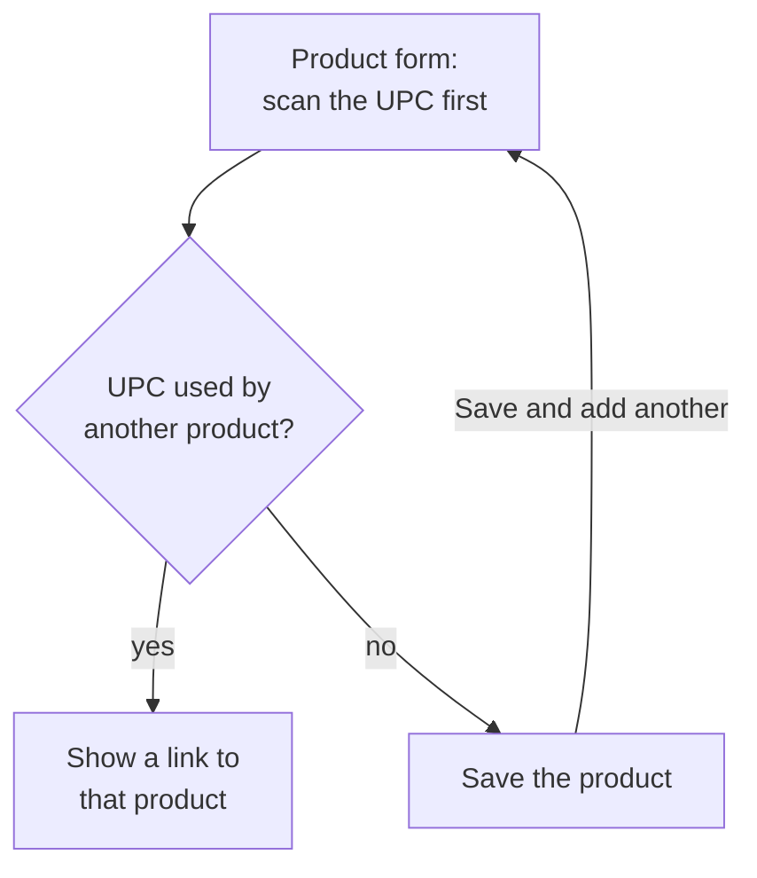
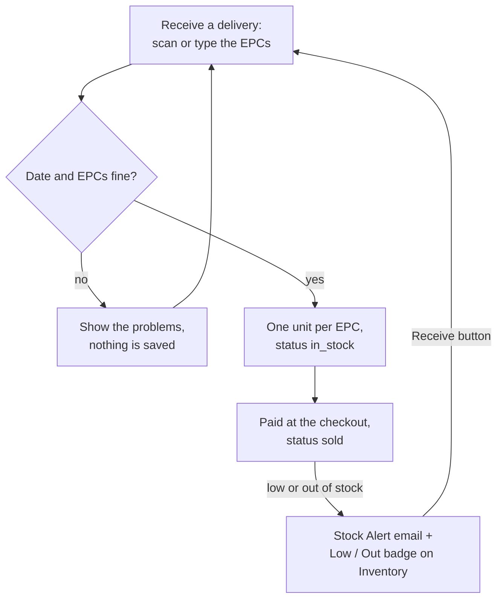

# Products and stock

A product is the thing on the shelf, like "Milk 1 L". A unit is one physical item of it, with its own RFID tag. Stock isn't stored as a number. It is counted from the units still marked `in_stock`, so it can't drift away from what was received and sold.

The tables are described in [database.md](database.md), and the RFID reader in [rfid-reader.md](rfid-reader.md).

## Contents
1. [Adding a product](#adding-a-product)
2. [A unit from delivery to sale](#a-unit-from-delivery-to-sale)
3. [Cost and profit](#cost-and-profit)
4. [Deleting a product](#deleting-a-product)
5. [Product images](#product-images)
6. [The inventory page](#the-inventory-page)
7. [Stock emails](#stock-emails)

## Adding a product

On the product form, the UPC box comes first and has the cursor, so an admin can scan the item in their hand before typing anything. The scanner's Enter moves the cursor to the name instead of sending the form. When the cursor leaves the UPC box, `product_form.js` asks `/products/upc-check` whether another product already has that UPC, and if so shows a link to it under the box. The server checks again when the form is saved. A new product has a "Save and add another" button, which saves it and opens an empty form.

## A unit from delivery to sale

On the receive form, the Scan tags button asks the reader again and again through `/rfid/scan`. New tags go into the box, and tags already in the system are listed but not added. A delivery can't be dated in the future and can't go on a hidden product.

## Cost and profit

Each product can have a cost per unit, what the store pays for it. A sale saves that cost on each receipt line, so changing a cost later doesn't change the profit of old sales. Units sold with no cost known are left out of the cost and the profit, and the pages that show profit say how many there are. The [dashboard and Reports](reports.md) show these numbers.

## Deleting a product

Deleting a product depends on its history:

| The product has... | What Delete does |
|---|---|
| No deliveries and no sales | Removed for good, along with its image |
| Deliveries or sales | Only hidden, because old receipts still need it |

Either way the admin goes back to the inventory page afterwards. Turning on "Show in inventory" on the product's form brings a hidden product back.

## Product images

Each product can have one image, handled by `models/product_image.py`.

1. Uploads can be JPG, PNG, WebP or GIF, up to 10 MB.
2. Opening the file with Pillow proves it really is an image, whatever its name says.
3. It is turned the right way up and shrunk to 800 px at most.
4. It is saved as WebP under a random name in `static/uploads/products/`. Saving it again also drops extras like a phone photo's GPS location.

## The inventory page

The inventory page (`/inventory`) lists what needs ordering first: out of stock, then low stock, then the rest. A product counts as low when its stock is at or below its own alert level.

Hidden products come last, with a grey Hidden badge, their own filter button, and an Edit button in place of Receive. They are left out of the numbers at the top, the low and out of stock counts, the dashboard and the CSV. `hidden_inventory_rows()` in `models/product.py` finds them, because the `ProductStock` view only has active products.

Each row shows the product ID, name, category, price, units in stock, units sold, the last delivery date and a status badge. The page keeps itself up to date: `static/js/products/inventory.js` asks `/api/inventory` for the numbers every 2 seconds and changes the cards, the stock column, the badges and the filter counts, so a sale at the checkout shows up without reloading. A product added after the page was opened only appears after a reload.

The page can also find any unit by EPC, including sold ones, and download the stock as a CSV (`/inventory.csv`). A product or category name that starts with `=`, `+`, `-` or `@` gets a `'` in front in the CSV, so Excel shows it as text instead of running it as a formula (`safe_cell()` in `routes/product_routes.py`). The Stock value at the top is the units in stock times the selling price.

## Stock emails

Two emails go to every account with the admin role. If there are no admins, they go to `ALERT_TO` in `config.py`. (Fridge alerts always go to `ALERT_TO`.)

| Email | Sent when | Not sent when | Templates |
|---|---|---|---|
| Stock Alert | A sale takes a product down to its alert level or to 0. One email covers the whole basket | The product stays above its alert level, was already low and still has some left, or is hidden | `templates/email/stock_alert.html`, `.txt` |
| Restocked | A delivery arrives for a product that was low or out of stock. It says how many came in, how many are now in stock, and whether the product is still low | The product was above its alert level before the delivery | `templates/email/restocked.html`, `.txt` |

`stock_alerts()` in `models/checkout.py` picks the products for a Stock Alert, and `receive_stock()` in `routes/product_routes.py` decides on a Restocked email.

`mail/send_email.py` fills in the templates during the web request, because they can't be filled in without one, then sends the email in a background thread. That way nobody waits for the email, and the sale or delivery is still saved if it fails. A failed email is not tried again, but the inventory page and the dashboard still show the product as low or out.
