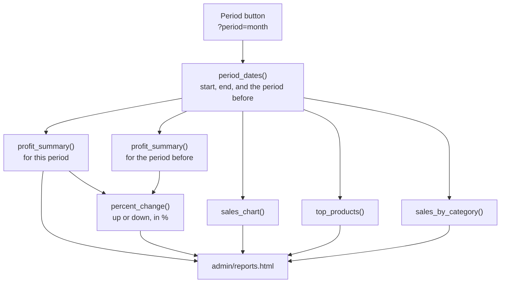

# Dashboard and reports

Two admin pages show how the store is doing: the dashboard (`/admin`) for today, and Reports (`/reports`) for a longer period. The queries behind them are explained in [database.md](database.md#sales-and-profit).

## Contents
1. [The dashboard](#the-dashboard)
2. [Reports](#reports)
3. [How Reports is built](#how-reports-is-built)
4. [Where the code is](#where-the-code-is)

## The dashboard

Admins land on the dashboard when they sign in. It is about today:

| Part | Shows |
|---|---|
| Today's numbers | Sales, orders, average order and profit so far today. Under each one is how much it went up or down since yesterday at the same time of day, or "No sales yesterday to compare with" |
| Needs attention | One line per problem, most urgent first, each with a button that goes to the fix. When the list is empty it says everything is caught up |
| Latest orders | The latest 6 orders |
| Last 7 days | A bar for each day (today's is dark) with its amount, and the 4 best sellers of those 7 days |
| Fridge 3 (MSP01) | Temperature, humidity, light and motion cards. See [msp01.md](msp01.md#dashboard-widgets) |

### Needs attention order

1. Fridges with a problem
2. Out of stock products
3. Products priced below their cost
4. Low stock products
5. Products with no cost yet

A fridge that is over its threshold gets a red banner at the top of the page (with whether the alert email went out), and is not repeated in the list. A fridge shows up in the list when its sensor hasn't sent anything for 15 seconds, or when there has been no reading at all. The 15 seconds match `static/js/fridges/common.js`. With `FRIDGES_ENABLED` on, the page reloads every 30 seconds so a new problem appears by itself. With it off, no fridge lines are shown.

## Reports

Reports has buttons for Today, This month, Last month and All time, with All time as the default. For the chosen period it shows:

| Part | Shows |
|---|---|
| Sales | Before tax (GST and QST go to the government), and the number of orders |
| Net profit | With the margin and the cost of the items sold |
| Average order | With the items per order |
| Tax owed | Split into GST and QST |
| Sales chart | Sales per day for a month, or per month for all time. Today has no chart |
| Best products | The 8 products that made the most profit, with the best seller's picture at the top. Each one's profit counts only its units with a cost |
| By category | Sales per category, with each category's share |

Each number except tax is compared with the period before:

| Period | Compared with |
|---|---|
| Today | Yesterday, up to the same time |
| This month | Last month, up to the same day |
| Last month | The month before |
| All time | Nothing to compare with |

## How Reports is built

## Where the code is

| Function | File | What it does |
|---|---|---|
| `period_dates()` | `models/checkout.py` | Turns a period into a start and end date, plus the dates of the period to compare with |
| `profit_summary()` | `models/checkout.py` | Sales, cost, profit, margin, tax and orders for a period |
| `top_products()` | `models/checkout.py` | Best products by profit |
| `sales_chart()`, `daily_sales()` | `models/checkout.py` | The bars of the charts |
| `sales_by_category()` | `models/checkout.py` | Sales per category |
| `recent_purchases()` | `models/checkout.py` | Latest orders for the dashboard |
| `products_below_cost()`, `products_without_cost()` | `models/product.py` | The pricing problems for Needs attention |
| `percent_change()` | `routes/admin_routes.py` | Up or down, in % |
| `money` filter | `routes/formats.py` | Shows amounts like `$1,314.50` or `-$16.00` |
