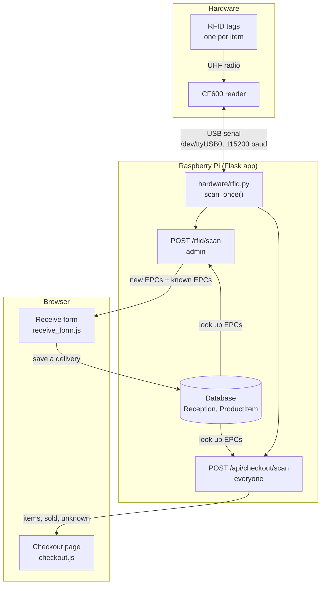
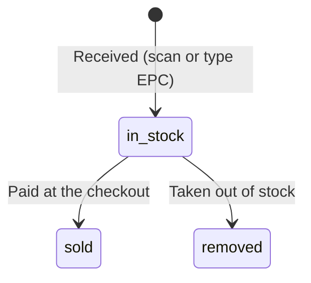

# UHF RFID reader (Chafon CF600)

The store uses a Chafon CF600 UHF RFID reader, plugged into the Raspberry Pi by USB. Every item on the shelf has its own RFID tag, and each tag has a unique code called an EPC (Electronic Product Code). The reader can see many tags at once, without a line of sight, so a whole basket is scanned in one go.

The app uses the reader in two places:

| Where | Who | What it does |
|---|---|---|
| Receive form (product page) | Admin | Reads the tags of a new delivery and adds their EPCs to the form |
| Self-checkout (`/`) | Customer | Reads the tags in the basket and puts the items in the shopping list |

The CF600 is a different device from the barcode scanner. The barcode scanner reads UPCs and membership cards, and works like a keyboard. See [Barcode scanner vs RFID reader](#barcode-scanner-vs-rfid-reader).

## Contents
1. [How it works](#how-it-works)
2. [Files](#files)
3. [Setup](#setup)
4. [Settings](#settings)
5. [Serial protocol](#serial-protocol)
6. [API](#api)
7. [Receiving stock](#receiving-stock)
8. [Checkout](#checkout)
9. [Database](#database)
10. [Barcode scanner vs RFID reader](#barcode-scanner-vs-rfid-reader)
11. [Testing without the reader](#testing-without-the-reader)
12. [Troubleshooting](#troubleshooting)

## How it works



1. While scanning, the page sends a request to the server about every 0.3 seconds after the last answer.
2. On the server, `scan_once()` in `hardware/rfid.py` sends the "inventory" command over the serial port, waits half a second, and reads the reply.
3. `parse_epcs()` finds each tag in the reply and turns its EPC into hex text, like `E2801160600002096D4B1C2F`. Each EPC is given back once, even if the reader saw it several times.
4. The route looks up the EPCs in the `ProductItem` table and sends JSON back to the page.

The reader never sends anything on its own. The app always asks first (polling), so nothing runs in the background while no page is scanning.

## Files

| File | What it does |
|---|---|
| `hardware/rfid.py` | Opens the serial port, sends the inventory command, decodes the reply. Also `setup_reader()`, which makes the port appear after a reboot |
| `app.py` | Calls `setup_reader()` before the website starts |
| `routes/product_routes.py` | `POST /rfid/scan`, for the receive form |
| `routes/checkout_routes.py` | `POST /api/checkout/scan`, for the checkout |
| `routes/__init__.py` | Turns a `ReaderError` (reader unplugged or not answering) into a JSON error with status 503 |
| `models/unit.py` | `known_epcs()`: which EPCs are already in the database |
| `models/reception.py` | Checks and saves a delivery (one `ProductItem` per EPC) |
| `models/checkout.py` | `basket_items()`: turns EPCs into basket items, and counts sold and unknown tags |
| `static/js/products/receive_form.js` | The Scan tags button on the receive form |
| `static/js/checkout/checkout.js` | The scan loop on the checkout page |
| `requirements.txt` | `pyserial`, the Python library for serial ports |

## Setup

### 1. Install pyserial
It is in `requirements.txt`, so `pip install -r requirements.txt` installs it.

### 2. Plug in the reader
Plug the CF600 into a USB port on the Pi. It shows up as a serial port, usually `/dev/ttyUSB0`.

### 3. The port after a reboot
The Pi doesn't know the CF600's USB ID, so after a reboot `/dev/ttyUSB0` is missing. You don't need to do anything: when the port isn't there, `app.py` runs this for you when it starts:
```
sudo modprobe usbserial vendor=0x0483 product=0x5750
```
This tells Linux's `usbserial` driver to handle the reader. It may ask for your password. You'll see one of these lines on the screen and in `logs/app.log`:
```
WARNING hardware.rfid: /dev/ttyUSB0 not found, loading the usbserial driver for the RFID reader...
INFO hardware.rfid: RFID reader ready on /dev/ttyUSB0
ERROR hardware.rfid: RFID reader still not found on /dev/ttyUSB0. Is it plugged in?
```
If the port is already there, nothing is printed. If the reader isn't found, the app still starts and only scanning fails.

### 4. Check `config.py`
```python
RFID_PORT = "/dev/ttyUSB0"
RFID_BAUD = 115200
```
To see which port the reader got:
```
ls /dev/ttyUSB* /dev/ttyACM*
```

## Settings

### `config.py`
| Setting | Default | Meaning |
|---|---|---|
| `RFID_PORT` | `/dev/ttyUSB0` | The reader's serial port. Use `/dev/ttyACM0` if that is what shows up |
| `RFID_BAUD` | `115200` | Serial speed. It must match the reader |

### Constants in the code
| Constant | Value | File | Meaning |
|---|---|---|---|
| `READ_TAGS` | `04 FF 01 1B B4` | `hardware/rfid.py` | The inventory command sent to the reader |
| `REPLY_WAIT` | 0.5 s | `hardware/rfid.py` | How long to wait for the reader's answer |
| `SCAN_PAUSE` | 300 ms | `receive_form.js`, `checkout.js` | Pause between two scans |
| `RETRY_PAUSE` | 3 s | `checkout.js` | Pause before trying again after the reader didn't answer |
| `MAX_EPC` | 24 | `models/reception.py` | Longest EPC allowed (24 hex characters = 96 bits) |

With the 0.5 s wait and the 0.3 s pause, the page gets a new list of tags about once every 0.8 seconds.

## Serial protocol

This section explains the bytes `hardware/rfid.py` sends and reads.

### Request
The app sends 5 bytes:

| Byte | Value | Meaning |
|---|---|---|
| 0 | `04` | Length of the rest of the frame |
| 1 | `FF` | Reader address (`FF` = any reader) |
| 2 | `01` | Command: inventory (which tags are in range right now) |
| 3 and 4 | `1B B4` | Checksum (CRC-16) |

### Reply
The reader answers with one frame per tag. Each frame starts with `CF`:

```
CF | addr | cmd (2 bytes) | len | status | rssi (2) | antenna | ? | epc_len | EPC ... | crc (2)
                                 |<------------------- len bytes ------------------>|
```

`parse_epcs()` reads it like this:
1. Find the next `CF` byte.
2. Read `len` (the 5th byte) to know where the frame ends.
3. If `status` is `00` (a tag was read), take `epc_len` bytes of EPC and turn them into hex text.
4. Move on to the next frame.

If the last frame was cut off, the leftover bytes are kept and joined to the start of the next read. The checksum of the reply is not checked.

### One request at a time
The serial port is shared by every request, so `scan_once()` uses a lock. If the checkout and the receive form scan at the same moment, one waits for the other. The port is opened the first time it is needed and kept open. If the reader is unplugged, the port is closed so the next scan tries again from scratch.

## API

Both routes are `POST` with no body. When the reader is unplugged or doesn't answer, both return status 503:
```json
{ "error": "Can't open the RFID reader on /dev/ttyUSB0. Is it plugged in? (...)" }
```

### `POST /rfid/scan`
Admins only. Used by the Scan tags button on the receive form.
```json
{
  "epcs": ["E2801160600002096D4B1C2F", "E2801160600002096D4B1C30"],
  "known": ["E2801160600002096D4B1A11"]
}
```
| Field | Meaning |
|---|---|
| `epcs` | Tags in range that are not in the database yet. These are the ones you can receive |
| `known` | Tags in range that are already in the database (any product, any status) |

### `POST /api/checkout/scan`
Anyone can call it. Used by the checkout page.
```json
{
  "items": [
    { "epc": "E2801160600002096D4B1C2F", "productID": 4, "name": "Milk 1 L",
      "price": 3.49, "taxable": false, "image": "/static/uploads/milk.jpg" }
  ],
  "sold": 0,
  "unknown": 1
}
```
| Field | Meaning |
|---|---|
| `items` | Tags in range whose unit is `in_stock`, with the product's details |
| `sold` | How many tags in range were already sold |
| `unknown` | How many tags in range are not in the database, or were removed |

## Receiving stock

On a product's page, the Receive stock form needs a date and the EPC of each unit.

1. Press Scan tags. The button turns blue and changes to Stop scanning.
2. Hold the new items near the reader. Each new EPC is added to the box, one per line.
3. Tags already in the database are left out. A note lists them while they are in range.
4. The button below shows how many units will be received, like "Receive 12 units".
5. Press Stop scanning, check the date, and press Receive.

You can also type or paste EPCs. Separate them with new lines, spaces, commas or semicolons. When saving, the app checks that:
- each EPC is hex (0 to 9, A to F) and at most 24 characters
- no EPC is in the list twice
- no EPC is already in the database
- the date isn't in the future, and the product isn't hidden

Then it saves one `Reception` row and one `ProductItem` row per EPC, all in one transaction. If one EPC is wrong, nothing is saved.

For testing, the Clear all EPCs button on a product page deletes all its units and deliveries, so the same tags can be received again. Receipts keep their lines.

## Checkout

The checkout page scans on its own, all the time, as long as the tab is visible.

| What happens | What the customer sees |
|---|---|
| A new tag comes into range | The item is added. "Added: Milk 1 L" |
| A tag already in the basket leaves range and comes back | "Item already scanned: Milk 1 L" (it is not added twice) |
| A tag that was already sold | "Item already sold" |
| A tag that isn't in the database | "1 item in range could not be recognised." |
| The customer removes an item with the trash button | The tag is ignored until it leaves the reader's range, so it isn't added straight back |
| The reader doesn't answer | The light next to the title says "Reader not answering", and a message asks the customer to get staff. The real error is in the browser console. It tries again every 3 seconds |

Scanning pauses while paying, so the paid items aren't added again. When payment is done, each unit is marked `sold` and linked to its receipt line. A sold tag can't go through the checkout a second time.

## Database

Each tagged item is one row in `ProductItem`. Stock is not stored as a number: it is the count of units that are `in_stock` (the `ProductStock` view). See [database.md](database.md) for the full schema.

The `ProductItem` table:

| Column | Type | Notes |
|---|---|---|
| `epc` | VARCHAR(24) | Primary key. The tag's EPC, in hex |
| `productID` | INTEGER | The product this unit belongs to |
| `receptionID` | INTEGER | The delivery it came in |
| `status` | VARCHAR(10) | `in_stock`, `sold` or `removed` |
| `purchaseItemID` | INTEGER | The receipt line it was sold on. Set only when `sold` |
| `expiryDate` | DATE | Optional |



The database allows `removed`, but no page sets it yet. The checkout counts a removed tag as unknown.

## Barcode scanner vs RFID reader

| | CF600 RFID reader | Barcode scanner |
|---|---|---|
| Reads | RFID tags (EPC) | Printed barcodes (UPC, membership card) |
| How many at once | Many, without line of sight | One, must be pointed at it |
| Connection | USB serial, read by `hardware/rfid.py` | USB keyboard: it types the code and presses Enter |
| Used for | Receiving stock, checkout basket | UPC on the product form, membership card sign-in |

## Testing without the reader

- To receive stock, type or paste EPCs in the box. Any hex text up to 24 characters works, like `ABC001`, `ABC002`.
- There is no fake reader, so the checkout needs the CF600 to add items. Without it, the page shows "Reader not answering". The rest of the site still works.
- To check the reader by hand, run this from the project folder:
  ```
  python -c "from hardware.rfid import scan_once; print(scan_once())"
  ```
  It prints the EPCs in range, like `['E2801160600002096D4B1C2F']`, or `[]` if none.

## Troubleshooting

| Message or symptom | Cause | Fix |
|---|---|---|
| `RFID reader still not found on /dev/ttyUSB0. Is it plugged in?` (ERROR, at start) | Reader unplugged, or it got a different port | Plug it in and restart the app. Run `ls /dev/ttyUSB* /dev/ttyACM*` and update `RFID_PORT` |
| `pyserial is not installed. Run: pip install pyserial` | Missing library | `pip install -r requirements.txt` inside the virtual environment |
| `Can't open the RFID reader on /dev/ttyUSB0. Is it plugged in? (...)` | The port doesn't exist, or another program is using it | Close other serial programs. If the end of the message says `Permission denied`, add your user to the `dialout` group (`sudo usermod -aG dialout $USER`) and log in again |
| `Lost the RFID reader on /dev/ttyUSB0. (...)` | Unplugged while running | Plug it back in. The next scan reconnects on its own |
| Checkout says "Reader not answering" | One of the errors above | Open the browser console (F12) to see the real message |
| Scan works but nothing is added at checkout | The tags aren't in the database | Receive them first on the product page |
| "Item already sold" | That tag was already paid for | Use another item, or Clear all EPCs on the product to reuse test tags |
| Tag not added on the receive form | It is already in the database (it shows in the "Already in the system" note) | Clear all EPCs on its product if you are testing |
| Some tags in the basket are missed | Too far from the antenna, or blocked by metal or liquid | Hold them closer and spread them out. The page keeps scanning, so they are added when read |
